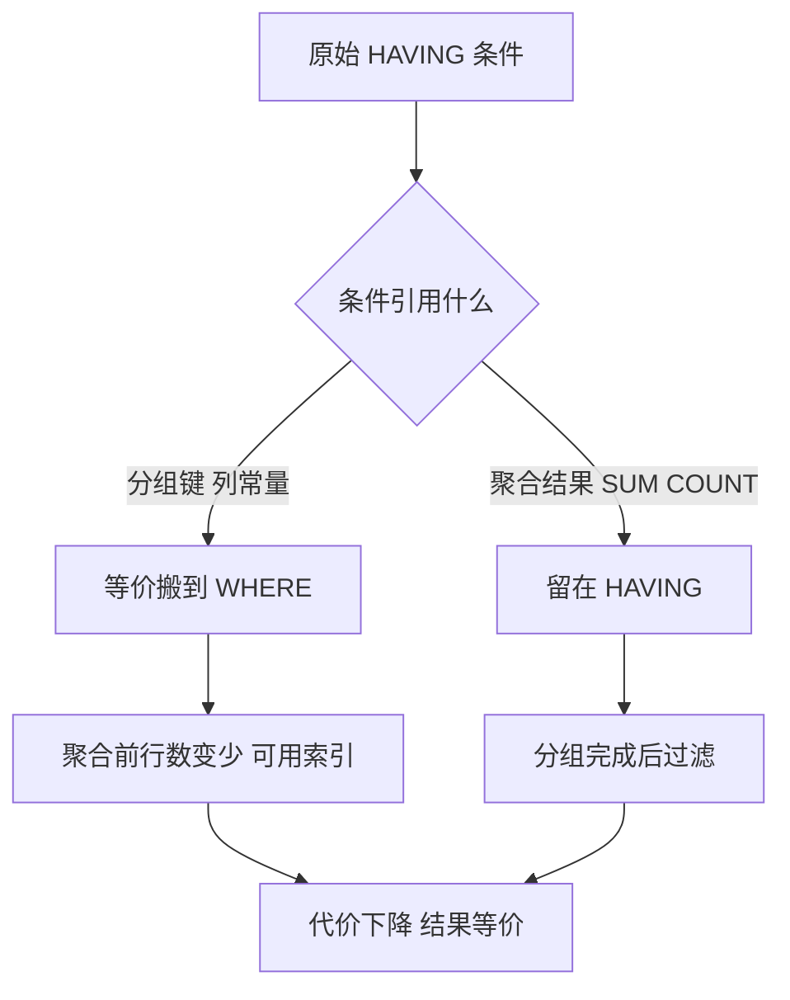

### Q2745 · HAVING 的下推改写: 能搬的条件别留在聚合后

> 难度:★★★★ | 标签:SQL, 调优

**问**:一条 GROUP BY 加 HAVING 的报表很慢,从 HAVING 上能挖出优化空间吗?

**答**:HAVING 里混着两类条件,优化空间就在分类上:分组键上的等值/IN 条件(如 HAVING region='north')可以等价搬到 WHERE——搬到聚合前过滤,参与分组的行直接变少,还能让优化器用上 region 上的索引避免全量分组;聚合结果上的条件(如 HAVING SUM(amt)>1000)不可下推,因为它的值在分组完成前根本不存在,这部分才是 HAVING 的本职。改写后用 EXPLAIN 验证:原来的 GROUP BY 临时表往往变成覆盖索引上的顺序扫描。纪律是:聚合前能删的行绝不过聚合,聚合后的 HAVING 只留真正依赖聚合值的条件。



```python
# file: code/04_数据库与缓存/q2745_having_pushdown.py
"""HAVING 的下推改写: 分组键条件搬进 WHERE, 聚合条件才留在 HAVING"""
import sqlite3
import time

conn = sqlite3.connect(":memory:")
c = conn.cursor()
c.execute("CREATE TABLE orders (id INTEGER PRIMARY KEY, region TEXT, amt REAL)")
rows = []
for i in range(1, 120001):
    rows.append((i, ("north", "south", "east", "west")[i % 4], (i % 300) + 0.5))
c.executemany("INSERT INTO orders VALUES(?,?,?)", rows)

slow_sql = """SELECT region, COUNT(*), SUM(amt) FROM orders
GROUP BY region
HAVING region = 'north' AND SUM(amt) > 100000"""
fast_sql = """SELECT region, COUNT(*), SUM(amt) FROM orders
WHERE region = 'north'
GROUP BY region
HAVING SUM(amt) > 100000"""

rs, rf = c.execute(slow_sql).fetchall(), c.execute(fast_sql).fetchall()
assert rs == rf, "下推改写必须等价"
print("两版结果一致:", rf)
print("改写前计划:", c.execute("EXPLAIN QUERY PLAN " + slow_sql).fetchall())
c.execute("CREATE INDEX idx_ra ON orders(region, amt)")
print("下推+覆盖索引计划:", c.execute("EXPLAIN QUERY PLAN " + fast_sql).fetchall())

def timed(sql):
    t0 = time.perf_counter()
    for _ in range(10):
        c.execute(sql).fetchall()
    return (time.perf_counter() - t0) * 1000 / 10

print("改写前每次 %.2f ms, 改写后每次 %.2f ms (聚合前先删行 免全量分组)"
      % (timed(slow_sql), timed(fast_sql)))
```

**追问**:
- 条件在 SELECT 列表里用了别名还能下推吗?—— 别名是输出层的语法糖,下推时必须写原始列表达式,否则语义就变了。
- 聚合条件太苛刻导致大部分组被扔掉呢?—— 那是 HAVING 的正常工作,优化方向转为先缩小参与聚合的数据集(时间分区 预过滤)。

---
