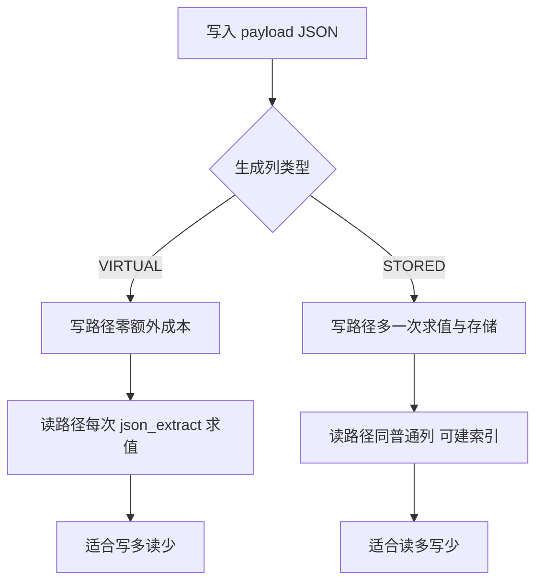

### Q2747 · JSON 字段的生成列: 提取一次 物化一处

> 难度:★★★☆ | 标签:JSON, 生成列

**问**:表里存了一段 JSON,经常按里面的某个字段查,怎么做才不慢?

**答**:直接 json_extract 查询意味着每行都在读路径上解析 JSON,索引帮不上忙。生成列是标准解:把 json_extract 表达式声明成列,数据库自动维护。VIRTUAL 生成列不占存储,写路径零额外成本,但每次读都要重新求值,和裸 json_extract 一样;STORED 生成列在写入时求值并物化,写慢一点,读路径与普通列完全相同,并且可以在其上建索引,等值和范围查询都走索引。选择口诀按读写比:写多读少用 VIRTUAL,读多写少用 STORED 加索引。它同时解决了 JSON 查询的两大痛点——无法索引和重复解析,是"schema 灵活"与"查询高效"之间的折中桥。



```python
# file: code/04_数据库与缓存/q2747_json_generated_col.py
"""JSON 字段的生成列: VIRTUAL 算在读 STORED 算在写, STORED 加索引后查询走索引"""
import json
import sqlite3
import time

conn = sqlite3.connect(":memory:")
c = conn.cursor()
N = 20000
payloads = [json.dumps({"uid": i, "amt": (i % 90) + 10}) for i in range(1, N + 1)]

def build(kind):
    ddl = "CREATE TABLE t_%s (id INTEGER PRIMARY KEY, payload TEXT" % kind
    coltype = {"virt": "VIRTUAL", "stor": "STORED"}.get(kind)
    if coltype:
        ddl += ", amt INTEGER GENERATED ALWAYS AS (json_extract(payload,'$.amt')) %s" % coltype
    c.execute(ddl + ")")
    t0 = time.perf_counter()
    c.executemany("INSERT INTO t_%s VALUES(?,?)" % kind,
                  [(i, p) for i, p in enumerate(payloads, 1)])
    return (time.perf_counter() - t0) * 1000

def query(kind):
    where = ("json_extract(payload,'$.amt')" if kind == "raw" else "amt") + " BETWEEN 20 AND 30"
    sql = "SELECT COUNT(*) FROM t_%s WHERE %s" % (kind, where)
    t0 = time.perf_counter()
    for _ in range(5):
        n = c.execute(sql).fetchone()[0]
    return n, (time.perf_counter() - t0) * 1000 / 5

w_raw = build("raw")
n1, r_raw = query("raw")
w_virt = build("virt")
n2, r_virt = query("virt")
w_stor = build("stor")
c.execute("CREATE INDEX idx_amt ON t_stor(amt)")
n3, r_stor = query("stor")

print("写入: raw %.0f ms | virtual %.0f ms | stored %.0f ms (stored 写时求值最慢)"
      % (w_raw, w_virt, w_stor))
print("查询均值: raw %.1f ms | virtual %.1f ms | stored+索引 %.1f ms, 命中 %d/%d/%d 行"
      % (r_raw, r_virt, r_stor, n1, n2, n3))
print("stored+索引计划:", c.execute(
    "EXPLAIN QUERY PLAN SELECT COUNT(*) FROM t_stor WHERE amt BETWEEN 20 AND 30").fetchone()[3])
```

**追问**:
- 表里已有数据能补建生成列吗?—— 可以,ALTER TABLE 加生成列时会自动回填 STORED 的值,VIRTUAL 则即时生效不回填。
- JSON 结构变了生成列会怎样?—— 表达式提取不到路径时按 NULL 处理,查询语义随之改变,结构演进要连生成列一起评审。

---
