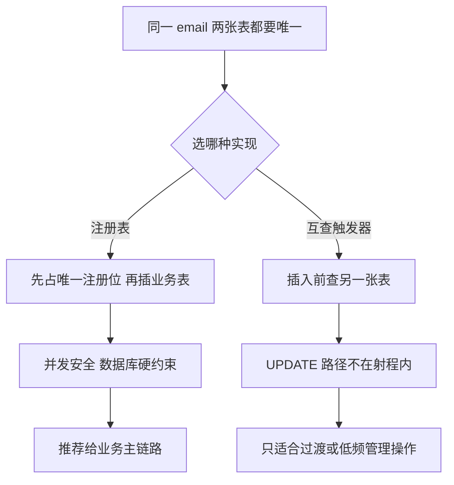

### Q2750 · 跨表唯一性的两种实现: 注册表硬约束与触发器软拦截

> 难度:★★★★ | 标签:约束, 并发

**问**:同一个邮箱在 customer 和 staff 两张表里都要唯一,数据库层怎么保证?

**答**:两种实现。硬方案是注册表:建一张 email_registry,对 email 建主键,任何表收新邮箱前先在同一事务里往注册表插一行,唯一冲突直接拦截——这是数据库级约束,并发下天然正确,任何写路径都绕不过。软方案是互查触发器:每张表的 BEFORE INSERT 触发器去查另一张表,能拦住普通的跨表重复插入;但它有两个盲区,一是 UPDATE 改邮箱不在 INSERT 触发器的射程里,漏配 UPDATE 触发器就破防,二是触发器逻辑藏在库内,新表接入容易遗忘。工程结论:主链路用注册表硬约束,触发器只做辅助提醒或历史包袱的过渡垫片,绝不当唯一防线。



```python
# file: code/04_数据库与缓存/q2750_cross_table_unique.py
"""跨表唯一性的两种实现: 注册表唯一约束 与 互查触发器 及其盲区"""
import os
import sqlite3
import tempfile
import threading
import time

dbpath = os.path.join(tempfile.mkdtemp(), "xtable.db")
admin = sqlite3.connect(dbpath, isolation_level=None)
admin.execute("PRAGMA journal_mode=WAL")
admin.execute("CREATE TABLE customer (id INTEGER PRIMARY KEY, email TEXT)")
admin.execute("CREATE TABLE staff (id INTEGER PRIMARY KEY, email TEXT)")
admin.execute("CREATE TABLE email_registry (email TEXT PRIMARY KEY, owner TEXT)")
admin.execute("""CREATE TRIGGER trg_customer_email BEFORE INSERT ON customer
  WHEN EXISTS (SELECT 1 FROM staff WHERE email = NEW.email)
  BEGIN SELECT RAISE(ABORT, 'email 已被 staff 占用'); END""")
admin.execute("""CREATE TRIGGER trg_staff_email BEFORE INSERT ON staff
  WHEN EXISTS (SELECT 1 FROM customer WHERE email = NEW.email)
  BEGIN SELECT RAISE(ABORT, 'email 已被 customer 占用'); END""")
admin.execute("INSERT INTO customer(email) VALUES('a@x.com')")

# 方案一: 触发器能拦住普通跨表插入
try:
    admin.execute("INSERT INTO staff(email) VALUES('a@x.com')")
    print("触发器方案: 漏拦了")
except sqlite3.IntegrityError as e:
    print("触发器拦截跨表插入: %s" % e)

# 盲区: UPDATE 改邮箱不在 BEFORE INSERT 触发器射程内
admin.execute("INSERT INTO staff(email) VALUES('race@x.com')")          # 通过
admin.execute("INSERT INTO customer(email) VALUES('tmp@x.com')")
admin.execute("UPDATE customer SET email='race@x.com' WHERE email='tmp@x.com'")  # 放行
n_s = admin.execute("SELECT COUNT(*) FROM staff WHERE email='race@x.com'").fetchone()[0]
n_c = admin.execute("SELECT COUNT(*) FROM customer WHERE email='race@x.com'").fetchone()[0]
print("触发器盲区: UPDATE 改邮箱后 staff %d 条 + customer %d 条 同邮箱共存" % (n_s, n_c))

# 方案二: 注册表唯一约束, 并发抢注也只有一个能成
def claim(conn, email, owner, hold):
    conn.execute("BEGIN IMMEDIATE")
    conn.execute("INSERT INTO email_registry VALUES(?,?)", (email, owner))
    time.sleep(hold)
    if owner == "customer":
        conn.execute("INSERT INTO customer(email) VALUES(?)", (email,))
    conn.execute("COMMIT")

out = []
def challenger(email):
    conn = sqlite3.connect(dbpath, isolation_level=None)
    conn.execute("PRAGMA busy_timeout=5000")
    time.sleep(0.05)
    try:
        claim(conn, email, "staff", 0)
        out.append("staff 竟然也抢到了 -> 破防")
    except sqlite3.IntegrityError as e:
        conn.execute("ROLLBACK")
        out.append("staff 被注册表唯一约束拦下: %s" % e)
    conn.close()

t = threading.Thread(target=challenger, args=("shared@x.com",))
t.start()
conn_a = sqlite3.connect(dbpath, isolation_level=None)
conn_a.execute("PRAGMA busy_timeout=5000")
claim(conn_a, "shared@x.com", "customer", 0.2)
t.join()
print(out[0])
print("注册表方案: 任何写路径 任何语句类型 都要过唯一约束这道物理闸门")
admin.close()
```

**追问**:
- 注册表方案的代价是什么?—— 每个新邮箱多一次插入,注册表成为热点小表,且要保证业务表与注册表始终同事务。
- 已有重复数据怎么上注册表?—— 先按邮箱分组对账清理,再建约束,和唯一索引上线预检是同一套流程。

---
