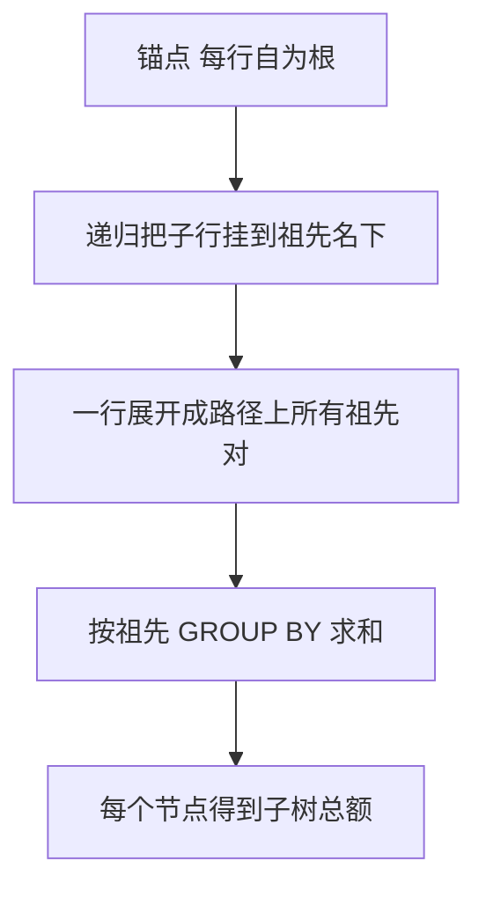

### Q2753 · 树的自底向上聚合: 递归 CTE 一次算出子树总额

> 难度:★★★★ | 标签:SQL, 递归CTE

**问**:类目树上每个节点要显示"子树合计金额",逐层往上加太啰嗦,一条 SQL 能算完吗?

**答**:能,标准手法是"每行自为根"的递归:锚点 SELECT 每个节点,把它自己标记为自己的祖先(root=id);递归项把每个子行挂到所有祖先名下,于是一行叶子数据被复制成"叶子到根路径上的每一对(祖先,叶子)"。外层按 root GROUP BY 求和,每个节点就同时拿到了自己子树的总额,一趟递归全部算完,不需要应用层逐层循环。它的代价是结果集按路径长度放大,深树和宽树的中间结果会明显变多,所以适合中小规模树(数千到数万节点);更大的树要预物化——闭包表或带 left/right 值的嵌套集,把递归从查询期挪到写入期。



```python
# file: code/04_数据库与缓存/q2753_tree_rollup.py
"""树的自底向上聚合: 每行自为根的递归, 一趟算出每个节点的子树总额"""
import sqlite3

conn = sqlite3.connect(":memory:")
c = conn.cursor()
c.execute("CREATE TABLE cat (id INTEGER PRIMARY KEY, parent INTEGER, amt REAL)")
# 1 总类目 <- 2 数码 <- 4 手机 5 电脑;  1 <- 3 服装 <- 6 上衣
c.executemany("INSERT INTO cat VALUES(?,?,?)",
              [(1, None, 0), (2, 1, 0), (3, 1, 0),
               (4, 2, 30), (5, 2, 50), (6, 3, 20)])

sql = """
WITH RECURSIVE down AS (
  SELECT id, id AS root, amt FROM cat
  UNION ALL
  SELECT c.id, d.root, c.amt FROM cat c JOIN down d ON c.parent = d.id
)
SELECT root, COUNT(*) AS nodes, SUM(amt) AS subtree_amt
FROM down GROUP BY root ORDER BY root
"""
for root, nodes, total in c.execute(sql):
    print("节点 %d: 子树 %d 个节点, 子树金额 %.0f" % (root, nodes, total))

expect = {1: 100, 2: 80, 3: 20, 4: 30, 5: 50, 6: 20}
for root, _, total in c.execute(sql):
    assert int(total) == expect[root], "子树聚合结果必须与手算一致"
print("子树总额与手算完全一致, 一次递归替代逐层回填")
```

**追问**:
- 结果集膨胀多少?—— 每个叶子被复制到根的深度次,总行数等于"所有节点到根的路径长度之和",深链树要警惕。
- 只要根节点的总额呢?—— 锚点只 SELECT 目标根,递归自然只在它的子树里走,代价大幅缩小。

---
