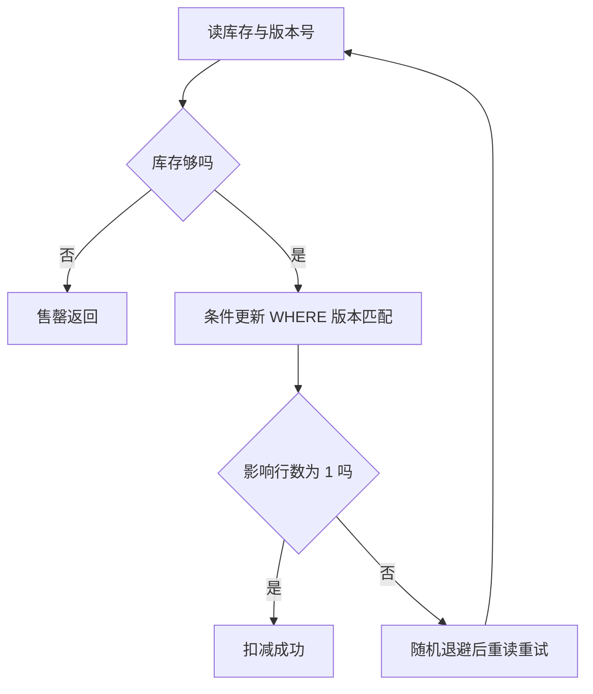

### Q2758 · 防超卖的乐观重试实测: 条件更新守门 版本号重试兜底

> 难度:★★★★ | 标签:并发, 乐观锁

**问**:秒杀场景 20 个人抢 5 件库存,不用悲观锁怎么保证一件都不超卖?

**答**:双保险。第一层是条件更新守门:UPDATE ... SET stock=stock-1 WHERE id=? AND stock>0,扣减原子地绑定在"还有货"这个前提上,超卖的物理路径不存在;第二层是版本号乐观重试:读到 stock 和 ver 后,UPDATE 带上 AND ver=?,并发写导致版本不匹配时影响行数为 0,读方重读重试而不是报错。实测把两层都跑起来:20 个线程抢 5 件,成交数恰好 5、最终库存 0,期间的冲突全部被重试消化。要点在重试的纪律:必须带次数上限和随机退避,否则热点冲突下重试风暴会把 CPU 和连接池一起打挂;退避后仍失败就走降级(排队或失败返回)。



```python
# file: code/04_数据库与缓存/q2758_oversell_retry.py
"""防超卖双保险实测: 条件更新守门 + 版本号乐观重试"""
import os
import random
import sqlite3
import tempfile
import threading
import time

dbpath = os.path.join(tempfile.mkdtemp(), "seckill.db")
init = sqlite3.connect(dbpath, isolation_level=None)
init.execute("PRAGMA journal_mode=WAL")
init.execute("CREATE TABLE goods (id INTEGER PRIMARY KEY, stock INTEGER, ver INTEGER)")
init.execute("INSERT INTO goods VALUES(1, 5, 0)")

sold = []
attempts = {"n": 0}
lock = threading.Lock()

def buyer(bid):
    conn = sqlite3.connect(dbpath, isolation_level=None)
    conn.execute("PRAGMA busy_timeout=3000")
    for _ in range(50):                              # 重试上限, 防风暴
        with lock:
            attempts["n"] += 1
        try:
            stock, ver = conn.execute(
                "SELECT stock, ver FROM goods WHERE id=1").fetchone()
            if stock <= 0:
                return False
            cur = conn.execute(
                "UPDATE goods SET stock=stock-1, ver=ver+1 "
                "WHERE id=1 AND stock=? AND ver=?", (stock, ver))
            if cur.rowcount == 1:
                with lock:
                    sold.append(bid)
                return True
        except sqlite3.OperationalError:
            pass                                     # 忙等也算一次失败重试
        time.sleep(random.uniform(0, 0.002))         # 随机退避
    return False

threads = [threading.Thread(target=buyer, args=(i,)) for i in range(20)]
for t in threads:
    t.start()
for t in threads:
    t.join()
stock = init.execute("SELECT stock FROM goods WHERE id=1").fetchone()[0]
assert stock >= 0 and len(sold) == 5 - stock
print("20 人抢 5 件: 成交 %d, 最终库存 %d, 总尝试 %d 次其中重试 %d 次"
      % (len(sold), stock, attempts["n"], attempts["n"] - len(sold)))
print("不变量: 成交数 + 剩余库存 = 初始库存, 超卖在条件更新下无路径发生")
init.close()
```

**追问**:
- 乐观重试和悲观锁怎么选?—— 冲突率低选乐观(白赚无锁读),冲突率高到重试成本超过等待成本选悲观;秒杀热点行基本必走悲观或队列。
- 版本号和 stock 条件是不是冗余?—— stock 条件保证业务不变量,版本号把"读-写之间被人改过"显式化,两者职责不同,热点行通常都带。

---
