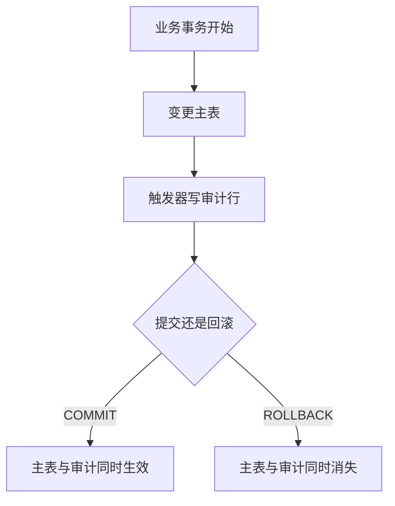

### Q2761 · 审计表与主表的事务同框: 回滚连审计一起回滚

> 难度:★★★☆ | 标签:审计, 事务

**问**:改余额要写审计流水,审计插入放在主事务里面还是外面?

**答**:必须同框。审计的意义是"发生过什么",它和业务变更要么同时生效要么同时不存在——放在同一事务里,业务回滚时审计自动消失,留下的是干净的一致状态;放在事务外,回滚后审计里会多出一条"从未发生的变更",审计表本身变成脏数据源。工程实现上,同事务插入是最直白的;要求"不漏"时用 AFTER UPDATE 触发器兜底,把审计逻辑从应用层下沉到库层,应用怎么写都绕不过。但注意审计内容里不要放与业务事务冲突的锁竞争点(如审计表的唯一序号生成),否则审计本身会成为热点。异步审计(先落消息再异步入审计表)则放弃了同框性,只适合可容忍丢失的场景。



```python
# file: code/04_数据库与缓存/q2761_audit_same_tx.py
"""审计表与主表的事务同框: 回滚连审计一起回滚, 触发器保证不漏"""
import sqlite3

conn = sqlite3.connect(":memory:", isolation_level=None)
c = conn.cursor()
c.execute("CREATE TABLE account (id INTEGER PRIMARY KEY, owner TEXT, bal INTEGER)")
c.execute("""CREATE TABLE audit (
    id INTEGER PRIMARY KEY AUTOINCREMENT, account_id INTEGER,
    delta INTEGER, note TEXT, at TEXT DEFAULT (datetime('now')))""")
c.execute("""CREATE TRIGGER account_audit AFTER UPDATE ON account
  WHEN OLD.bal <> NEW.bal
  BEGIN
    INSERT INTO audit(account_id, delta, note) VALUES(NEW.id, NEW.bal - OLD.bal, 'balance');
  END""")
c.execute("INSERT INTO account VALUES(1, 'alice', 100)")

c.execute("BEGIN")                          # 成功路径: 业务与审计同事务落盘
c.execute("UPDATE account SET bal = bal - 30 WHERE id=1")
c.execute("COMMIT")
print("扣款 30 后审计:", c.execute("SELECT account_id, delta, note FROM audit").fetchall())

c.execute("BEGIN")                          # 失败路径: 业务回滚, 审计必须一起消失
c.execute("UPDATE account SET bal = bal + 999 WHERE id=1")
c.execute("ROLLBACK")
n = c.execute("SELECT COUNT(*) FROM audit WHERE delta=999").fetchone()[0]
print("回滚后 delta=999 的审计条数: %d (0 才对, 审计与业务同生死)" % n)
print("最终账实:", c.execute("SELECT bal FROM account WHERE id=1").fetchone()[0])
conn.close()
```

**追问**:
- 审计表要不要可关闭?—— 高频表上触发器审计有开销,可按表粒度开关,但关闭动作本身要留痕。
- 审计表膨胀怎么办?—— 审计只追加不更新,按时间分区加归档,查询走时间索引。

---
