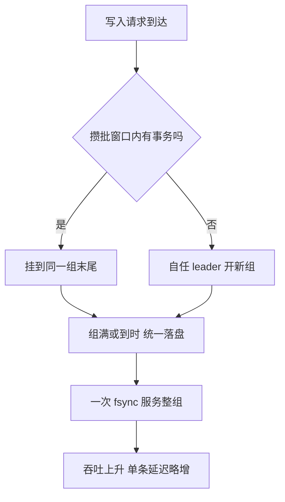

### Q2763 · 组提交的概念: 攒批把 100 次落盘并成 2 次

> 难度:★★★☆ | 标签:事务, 落盘

**问**:组提交(group commit)解决什么问题?为什么高并发写入离不开它?

**答**:落盘是事务最贵的动作,一次 fsync 的代价远超内存操作,逐条提交时每条事务都要独占一次 fsync,磁盘吞吐成为天花板。组提交的思路是攒批:leader 事务带着同一窗口内排队的其他事务一起落盘,一次 fsync 服务整组,单条均摊的落盘代价随并发下降——并发越高效果越明显,这正是它和"应用层攒批"的本质区别:组提交在数据库内部自动发生,不需要业务改代码。代价是单条延迟略增(等攒批窗口)且组内事务共同进退。实测用逐条提交与攒批提交对比落盘次数与耗时,差距就是组提交赚到的部分。写密集系统的压测曲线里,"并发上去吞吐反而升"的现象,基本都有组提交的功劳。



```python
# file: code/04_数据库与缓存/q2763_group_commit.py
"""组提交的概念: 逐条提交与攒批提交的落盘次数与耗时对比"""
import os
import sqlite3
import tempfile
import time

d = tempfile.mkdtemp()

def run(label, per_commit, total=100):
    db = os.path.join(d, "gc_%s.db" % label)
    conn = sqlite3.connect(db, isolation_level=None)
    conn.execute("PRAGMA journal_mode=DELETE")   # 回滚日志模式, 每事务一次完整落盘
    conn.execute("PRAGMA synchronous=FULL")      # 每次提交强制 fsync
    conn.execute("CREATE TABLE t (id INTEGER PRIMARY KEY, v INTEGER)")
    t0 = time.perf_counter()
    done = 0
    commits = 0
    while done < total:
        conn.execute("BEGIN")
        for _ in range(min(per_commit, total - done)):
            done += 1
            conn.execute("INSERT INTO t VALUES(?,?)", (done, done))
        conn.execute("COMMIT")                   # 每个事务对应一次真正的落盘
        commits += 1
    cost = (time.perf_counter() - t0) * 1000
    conn.close()
    os.remove(db)
    return commits, cost

c1 = run("solo", 1)
c50 = run("group50", 50)
print("100 行: 逐条提交 %d 次落盘 耗时 %.0f ms | 攒 50 条一组 %d 次落盘 耗时 %.0f ms"
      % (c1[0], c1[1], c50[0], c50[1]))
print("组提交在数据库内部自动攒批, 并发越高, 单条均摊的落盘代价越低")
```

**追问**:
- 应用层还能再攒一层吗?—— 能,批量接口把 N 条业务合并成一个事务,与组提交叠加,但要注意单事务别过大(Q 里的拆分原则)。
- 组提交对持久性有损失吗?—— 没有,组内事务要么都落盘要么都未提交,D 姓保持完整。

---
