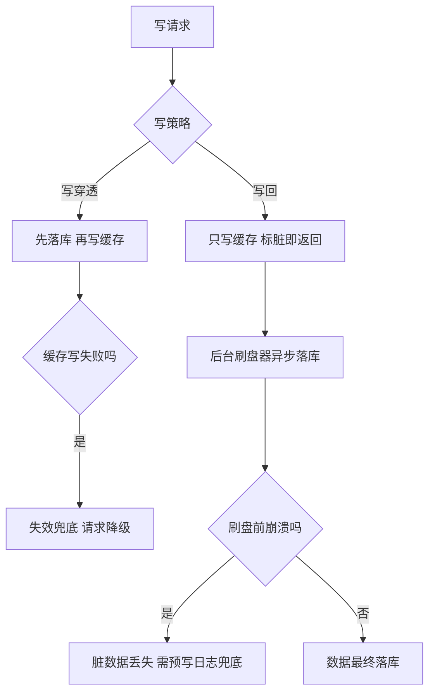

### Q2767 · 写穿透与写回的失败注入: 一个阻塞一个丢数据

> 难度:★★★★ | 标签:缓存, 写策略

**问**:写穿透和写回两种写策略,缓存故障时各自死法有什么不同?

**答**:写穿透把缓存写放在关键路径上:先落库再写缓存,缓存挂了表现为请求失败或降级——数据安全但可用性受损;兜底纪律是缓存写失败时执行失效而不是留下旧值,让下次读回源,宁可 miss 不可 stale。写回把缓存写当成功即返回,脏数据由后台刷盘器异步落库:请求延迟最低、写入可合并,但失败注入暴露出它的死穴——刷盘前崩溃,脏数据永久丢失,连"重试"的机会都没有,因为它没进任何持久层。所以纯写回只配给可丢数据(计数、统计)场景;要保数据就必须加预写日志或多副本,复杂度立刻上一个台阶。失败注入实验的价值就是把这两种死法在测试环境里演出来,而不是在故障复盘时第一次见到。



```python
# file: code/04_数据库与缓存/q2767_write_through_back_fail.py
"""写穿透与写回的失败注入: 写穿透失败是阻塞, 写回失败是丢数据"""
class FlakyCache:
    def __init__(self):
        self.data = {}
        self.fail_put = False
        self.fail_flush = False

    def put(self, k, v):
        if self.fail_put:
            raise IOError("缓存不可写")
        self.data[k] = v

    def flush(self, pending):
        if self.fail_flush:
            raise IOError("刷盘失败")
        self.data.update(pending)


db = {}
cache = FlakyCache()

# 写穿透: 先落库再写缓存, 缓存写失败按失效处理, 不留旧值
cache.fail_put = True
try:
    db["p:1"] = "新值"
    cache.put("p:1", "新值")
except IOError as e:
    cache.data.pop("p:1", None)
    print("写穿透失败: %s -> 库已更新, 缓存按失效处理, 下次读回源" % e)
cache.fail_put = False
cache.put("p:1", "新值")
print("写穿透恢复: 缓存 %s" % cache.data)

# 写回: 请求只写缓存即返回, 刷盘前崩溃就是永久丢失
dirty = {"p:2": "新值"}
print("写回: 请求已返回, 脏数据 %s 尚未落库, db 里还是 %s" % (dirty, db.get("p:2")))
cache2 = FlakyCache()
cache2.fail_flush = True
try:
    cache2.flush(dirty)
except IOError as e:
    print("写回失败: %s -> 若此刻进程崩溃, p:2 的写入永久丢失" % e)
print("结论: 可丢数据才用纯写回, 要保数据配预写日志, 或直接退回写穿透")
```

**追问**:
- 写回的脏数据窗口能压缩到多小?—— 刷盘间隔调小、按脏页量触发、关机钩子里强刷,但只要异步存在,窗口就不为零。
- 写穿透的"库成功缓存失败"还有第三种处理吗?—— 有,记录失效事件交给后台补写,把同步降级改成异步收敛,但窗口内要容忍 miss。

---
