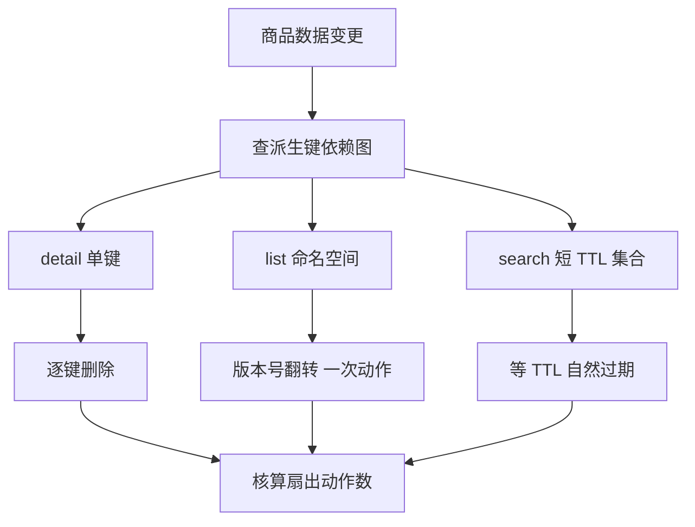

### Q2772 · 失效扇出的核算: 一次写到底要删多少个派生键

> 难度:★★★★ | 标签:缓存, 失效

**问**:商品改个价格,详情页、列表页、搜索缓存全要失效,这个扇出怎么管理?

**答**:先核算再定策略。把一次写会波及的派生键列成依赖图:详情键 1 个、它所在分类的列表页几十个、命中它的搜索结果几百个、推荐位若干——把"一次写的失效动作数"算出来,这个数就是写路径的隐性放大系数。然后按节点类型分派策略:单键且关键的(详情)逐键删除;命名空间型的(列表页)不逐页删,翻版本号一次动作搞定;容忍陈旧的(搜索结果)干脆不主动失效,靠短 TTL 自然过期。三类策略混用后,实际的同步失效动作数从上千降到个位数,剩下的交给版本和 TTL 异步收敛。扇出核算应该出现在设计评审里:算不出来扇出数的缓存设计,等于没设计。



```python
# file: code/04_数据库与缓存/q2772_invalidation_fanout.py
"""失效扇出核算: 一次商品写波及多少派生键, 三种策略各摊多少"""
CATS, PAGES_PER_CAT, SEARCH_HITS = 1, 50, 200

def naive_fanout():
    """全部逐键删除: 详情 1 + 该商品所在分类全部列表页 + 命中它的搜索页 + 推荐位"""
    return 1 + PAGES_PER_CAT + SEARCH_HITS + 1

def strategy_fanout():
    """详情逐键删 1, 列表翻版本号 1, 搜索靠 TTL 0, 推荐 TTL 0"""
    return 2

print("商品改价一次, 派生键: 列表页 %d + 搜索页 %d + 详情与推荐 %d"
      % (PAGES_PER_CAT, SEARCH_HITS, 2))
print("全部逐键删除: %d 个失效动作 (写路径的隐性放大系数)" % naive_fanout())
print("按类型分派策略后: %d 个同步动作, 其余交给版本号与 TTL 异步收敛" % strategy_fanout())
assert strategy_fanout() < naive_fanout()
print("设计评审必答题: 一次写的失效扇出是多少? 答不出来等于没设计")
```

**追问**:
- 依赖图谁来维护?—— 写路径代码里显式声明最可靠,自动推断(key 命名约定反查)可以做审计但别当唯一事实源。
- 版本号翻转对列表页的代价?—— 整个命名空间全部冷启动,回源率瞬时抬升,要错峰(Q 批量失效专题)或只翻转受影响的子空间。

---
