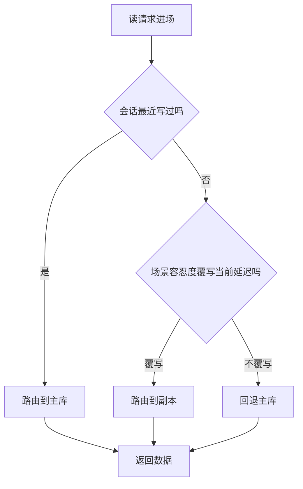

### Q2777 · 只读副本的读延迟容忍: 按场景标容忍度 写令牌保读己之写

> 难度:★★★★ | 标签:复制, 一致性

**问**:有主从复制延迟,读流量怎么分才不会读到旧数据惹出业务事故?

**答**:关键动作是给每个读场景标注容忍度,路由按容忍度决策:秒级的延迟对"个人主页刷新""推荐流"无所谓,走副本;支付结果、余额这类零容忍场景必须走主库。容忍度表把"能不能读到旧值"从工程直觉变成显式配置,评审和故障排查都有据可依。再加一层写令牌保读己之写:用户刚写入(如下单成功跳转详情页)后的短窗口内,该会话的读强制路由主库,窗口过后恢复正常路由——这是延迟架构下用户体验的最后防线。运行时要盯副本延迟与容忍度的差值:延迟逼近各场景容忍度时提前告警,而不是等用户投诉。延迟尖峰期间,路由自动把超出容忍度的场景回切主库,主库压力随之上升,要有容量预案。



```python
# file: code/04_数据库与缓存/q2777_replica_lag_tolerance.py
"""只读副本的读延迟容忍: 场景标注容忍度, 写令牌保读己之写"""
LAG_S = [2.0]      # 当前观测到的副本延迟

TOLERANCE = {"profile": 5.0, "recommend": 60.0, "payment": 0.0}

def route(scene, session_last_write_ago):
    tol = TOLERANCE[scene]
    if session_last_write_ago is not None and session_last_write_ago < 3.0:
        return "primary", "会话 3 秒内写过, 读己之写"
    if tol == 0.0:
        return "primary", "该场景零容忍"
    if LAG_S[0] > tol:
        return "primary", "副本延迟 %.0fs 超过容忍度 %.0fs" % (LAG_S[0], tol)
    return "replica", "延迟 %.0fs 在容忍度 %.0fs 内" % (LAG_S[0], tol)

cases = [("profile", None), ("profile", 1.0), ("recommend", None),
         ("payment", None), ("recommend", 10.0)]
for scene, ago in cases:
    target, why = route(scene, ago)
    print("%-10s 会话写于 %s -> %-8s (%s)"
          % (scene, "刚刚" if ago is not None else "很久前", target, why))

LAG_S[0] = 12.0
print("--- 延迟尖峰到 12s 之后 ---")
for scene in ("profile", "recommend"):
    target, why = route(scene, None)
    print("%-10s -> %-8s (%s)" % (scene, target, why))
```

**追问**:
- 写令牌存哪?—— 会话级存储(分布式缓存或粘性会话),记录最后写时间,读路由时校验;窗口取主从延迟的 P99 加余量。
- 副本延迟的容忍度表谁维护?—— 业务负责人提需求、平台定模板,作为读路由配置随代码评审,新增读场景必须填。

---
