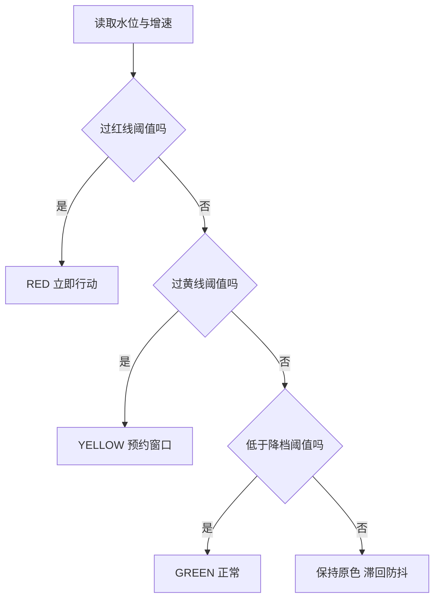

### Q2780 · 容量预警的三色阈值: 带滞回的状态机与剩余天数加速

> 难度:★★★☆ | 标签:运维, 容量

**问**:磁盘 80% 就告警,结果天天告警天天狼来了,怎么把容量预警做准?

**答**:三色阈值加两个修正。基础是状态机:GREEN 正常、YELLOW 预约扩容窗口、RED 立即行动,阈值分级让响应动作与紧急程度匹配。修正一是滞回(hysteresis):升档阈值高、降档阈值低,比如 70% 升黄但要降到 65% 以下才回绿,水位在边界抖动时状态不跟着反复横跳,告警不再狼来了。修正二是剩余天数加速:比水位更重要的是增速——按最近增速外推"还有几天满",days_left 低于 7 天直接 RED,哪怕水位只有 60%,快满的慢水位比高位的水位更危险。两级信号(绝对水位 + 相对增速)叠加滞回状态机,就是容量预警的完整形态,缓存内存、磁盘、连接数配额都适用同一套。



```python
# file: code/04_数据库与缓存/q2780_capacity_thresholds.py
"""容量预警的三色阈值: 滞回状态机 + 剩余天数加速定级"""
def classify(pct, days_left, prev):
    if pct >= 85 or days_left <= 7:
        return "RED"
    if prev == "RED":                          # 红色降档更苛刻, 防抖
        if pct < 80 and days_left > 7:
            return "YELLOW" if pct >= 65 else "GREEN"
        return "RED"
    if pct >= 70 or days_left <= 30:
        return "YELLOW"
    if prev == "YELLOW":
        return "GREEN" if (pct < 65 and days_left > 30) else "YELLOW"
    return "GREEN"

series = [
    (60, 90, None),      # 正常
    (72, 40, None),      # 升黄
    (66, 40, "YELLOW"),  # 回落但未过降档阈值, 滞回保持黄
    (64, 40, "YELLOW"),  # 过降档阈值, 回绿
    (88, 40, None),      # 直升红
    (82, 40, "RED"),     # 未过红色降档线, 保持红
    (78, 40, "RED"),     # 降到黄
    (50, 5,  "YELLOW"),  # 水位不高但 5 天就满, 剩余天数加速直判红
]
for pct, days, prev in series:
    print("水位 %2d%%, 剩余 %2d 天, 上一状态 %-6s -> %s"
          % (pct, days, prev or "-", classify(pct, days, prev)))
```

**追问**:
- 增速怎么算才稳?—— 用最近 7 天的线性回归斜率而不是最后两点差值,避免一次批量任务把增速打歪。
- 通知怎么随颜色分级?—— GREEN 不发,YELLOW 进日报并开工单,RED 值班通道即时呼叫,动作与颜色严格绑定。

---
