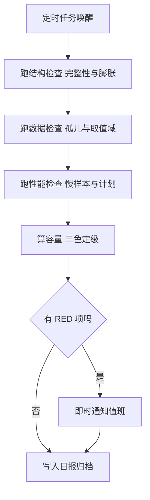

### Q2785 · 综合案例: 一份夜间巡检报告的自动生成

> 难度:★★★★ | 标签:运维, 综合

**问**:把这一批的巡检项、三色阈值、慢样本留存放在一起,自动生成一份夜间巡检报告,怎么设计?

**答**:流水线四步:构造检查对象(库里故意埋了膨胀、孤儿、无索引慢查询三类问题)、跑检查清单(每项三态输出与量化详情)、定级汇总(取所有检查的最差状态作为总体色)、按色输出行动清单(RED 即时通知,YELLOW 进工单,GREEN 归档)。设计原则与前面的专题一一对应:检查函数只读、结果量化(膨胀带 MB 数、慢查询带耗时与计划)、容量用三色加剩余天数、慢样本带指纹。报告的价值不只是"发现",而是"发现即带建议"——每条 WARN/FAIL 后面跟处置动作,值班人员照单执行。演练时故意埋问题,验证报告能全部命中,比上线后第一次见到真故障再调靠谱得多。



```python
# file: code/04_数据库与缓存/q2785_night_inspection_report.py
"""综合案例: 夜间巡检报告的自动生成, 检查 三色定级与行动清单"""
import os
import sqlite3
import tempfile
import time

dbpath = os.path.join(tempfile.mkdtemp(), "night.db")
conn = sqlite3.connect(dbpath, isolation_level=None)
conn.execute("PRAGMA page_size=4096")
conn.execute("CREATE TABLE users (id INTEGER PRIMARY KEY, name TEXT)")
conn.execute("""CREATE TABLE orders (id INTEGER PRIMARY KEY, user_id INTEGER,
                amt REAL, created TEXT)""")
conn.execute("BEGIN IMMEDIATE")
conn.executemany("INSERT INTO users VALUES(?,?)", [(i, "u%d" % i) for i in range(1, 2001)])
conn.executemany("INSERT INTO orders VALUES(?,?,?,?)",
                 [(i, (i % 2000) + 1, (i % 90) + 1.0, "2026-10-%02d" % ((i % 28) + 1))
                  for i in range(1, 12001)])
conn.execute("COMMIT")
conn.execute("DELETE FROM orders WHERE id % 3 = 0")          # 埋问题 1: 膨胀
conn.execute("DELETE FROM users WHERE id IN (5, 7, 9)")      # 埋问题 2: 孤儿订单

CHECKS = []
def check(name):
    def deco(fn):
        CHECKS.append((name, fn))
        return fn
    return deco

@check("库完整性")
def _(conn):
    r = conn.execute("PRAGMA quick_check").fetchone()[0]
    return ("PASS" if r == "ok" else "FAIL", r)

@check("表膨胀水位")
def _(conn):
    pc = conn.execute("PRAGMA page_count").fetchone()[0]
    fl = conn.execute("PRAGMA freelist_count").fetchone()[0]
    ratio = fl / max(1, pc)
    state = "RED" if ratio > 0.5 else ("YELLOW" if ratio > 0.2 else "GREEN")
    return (state, "freelist 占 %.0f%%, 可回收约 %.1f MB"
            % (ratio * 100, fl * 4096 / 1048576.0))

@check("孤儿订单")
def _(conn):
    n = conn.execute("""SELECT COUNT(*) FROM orders o
                        LEFT JOIN users u ON u.id = o.user_id
                        WHERE u.id IS NULL""").fetchone()[0]
    return ("YELLOW" if n else "GREEN", "%d 条订单指向不存在的用户, 需回溯删除路径" % n)

@check("热点查询计划")
def _(conn):
    sql = "SELECT COUNT(*) FROM orders WHERE created = '2026-10-03'"
    plan = conn.execute("EXPLAIN QUERY PLAN " + sql).fetchone()[3]
    t0 = time.perf_counter()
    conn.execute(sql).fetchone()
    ms = (time.perf_counter() - t0) * 1000
    bad = "SCAN" in plan
    return ("YELLOW" if bad else "GREEN",
            "%s, %.1f ms%s" % (plan, ms, " -> 建议 created 建索引" if bad else ""))

@check("容量水位")
def _(conn):
    used_gb, cap_gb, growth = 17.0, 20.0, 1.0     # 用量 上限 日增速
    pct = used_gb / cap_gb * 100
    days_left = (cap_gb - used_gb) / growth
    state = "RED" if (pct >= 85 or days_left <= 7) else ("YELLOW" if pct >= 70 else "GREEN")
    return (state, "水位 %.0f%%, 按当前增速剩 %.0f 天, 建议本周走扩容变更" % (pct, days_left))

rank = {"GREEN": 0, "YELLOW": 1, "RED": 2}
report = []
overall = "GREEN"
for name, fn in CHECKS:
    state, detail = fn(conn)
    report.append((name, state, detail))
    color = {"PASS": "GREEN", "FAIL": "RED"}.get(state, state)
    if rank[color] > rank[overall]:
        overall = color

print("=" * 62)
print("夜间巡检报告  %s" % time.strftime("%Y-%m-%d %H:%M"))
print("=" * 62)
for name, state, detail in report:
    print("[%s] %-8s %s" % (state, name, detail))
print("-" * 62)
print("总体定级: %s" % overall)
if overall == "RED":
    print("行动清单: 通知值班; 磁盘扩容走变更单; 膨胀表预约清理窗口; 孤儿数据补修复任务")
elif overall == "YELLOW":
    print("行动清单: 各 WARN 项开工单, 纳入日跟进")
else:
    print("一切正常, 报告归档")
conn.close()
```

**追问**:
- 巡检报告怎么防止"报了没人看"?—— RED 走即时呼叫、YELLOW 进工单系统带截止时间、日报里只放变化项,把看报告的成本压到最低。
- 检查清单怎么持续生长?—— 每次故障复盘产出至少一个新检查项并先在演练库验证,清单版本随代码一起评审上线。

---
