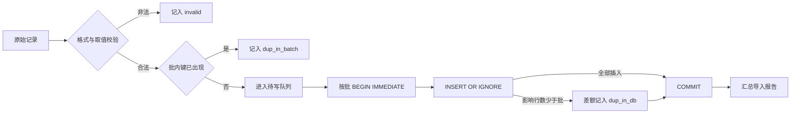

### Q2941 · 批量导入的完整管线: 校验 去重 分批 事务 四步闭环

> 难度:★★★★ | 标签:批量导入, 数据质量

**问**:运营甩来一份十万行的 Excel 要导库,重复、脏数据、库里已有都有可能,你的导入管线怎么设计?

**答**:完整管线四步闭环。第一步校验:格式与取值合法性逐条过,脏数据在进库前被拦下并计数,绝不让它污染后面步骤。第二步批内去重:用 seen 集合挡住同一批里的重复键,批内重复与跨批重复要分开计数,因为它们的成因不同。第三步分批:大文件切成固定大小的批,每批一个短事务,单批失败只回滚一批,不会出现整库大事务;批大小通常几百到几千,配合限速控制主库压力。第四步事务兜底:INSERT OR IGNORE 加唯一约束挡住与库内已有数据的冲突,用影响行数与批大小的差额精确统计"库里已存在"的数量,最后汇总成报告,每一类数据的去向都可解释、可追溯。



```python
# file: code/04_数据库与缓存/q2941_import_pipeline.py
"""批量导入完整管线: 校验 去重 分批 事务 四步闭环出报告"""
import sqlite3

RAW = [
    ("u1", "a@x.com", 20),       # 合法
    ("u2", "b@x.com", 31),       # 合法
    ("u2", "b@x.com", 32),       # 批内重复
    ("", "c@x.com", 22),         # 校验失败: 名称为空
    ("u3", "not-an-email", 18),  # 校验失败: 邮箱格式
    ("u4", "d@x.com", -5),       # 校验失败: 年龄非法
    ("u1", "a@x.com", 20),       # 与批内第一条重复
    ("u5", "e@x.com", 40),       # 库里已存在, 走唯一约束兜底
    ("u6", "f@x.com", 28),       # 合法
]


def valid(rec):
    name, email, age = rec
    return bool(name) and "@" in email and 0 <= age <= 150


conn = sqlite3.connect(":memory:")
conn.isolation_level = None   # 关掉隐式事务, 手动 BEGIN IMMEDIATE 才有效
conn.execute("CREATE TABLE user(name TEXT PRIMARY KEY, email TEXT, age INTEGER)")
conn.execute("INSERT INTO user VALUES('u5','e@x.com',40)")


def import_rows(records, batch_size=3):
    stats = {"total": len(records), "invalid": 0, "dup_in_batch": 0,
             "dup_in_db": 0, "inserted": 0, "batches": 0}
    seen, clean = set(), []
    # 第 1 步: 校验 + 批内去重, 脏数据不进库
    for rec in records:
        if not valid(rec):
            stats["invalid"] += 1
            continue
        if rec[0] in seen:
            stats["dup_in_batch"] += 1
            continue
        seen.add(rec[0])
        clean.append(rec)
    # 第 2 步: 分批 + 每批一个短事务, 唯一约束兜库里已存在的键
    for i in range(0, len(clean), batch_size):
        batch = clean[i:i + batch_size]
        stats["batches"] += 1
        try:
            conn.execute("BEGIN IMMEDIATE")
            before = conn.total_changes
            conn.executemany("INSERT OR IGNORE INTO user VALUES(?,?,?)", batch)
            after = conn.total_changes
            stats["dup_in_db"] += len(batch) - (after - before)
            stats["inserted"] += after - before
            conn.commit()
        except Exception:
            conn.rollback()
            raise
    return stats


report = import_rows(RAW, batch_size=3)
print("导入报告:", report)
print("库内行数:", conn.execute("SELECT COUNT(*) FROM user").fetchone()[0])
assert report["invalid"] == 3 and report["dup_in_batch"] == 2
assert report["dup_in_db"] == 1 and report["inserted"] == 3
assert report["batches"] == 2
print("四步闭环自检通过: 校验挡脏 批内去重 约束兜底 分批短事务")
```

**追问**:
- 导入到一半想停,已导入的怎么办?—— 每批带 batch_id 落一张导入流水表,重跑时按流水断点续跑,见 Q1967 的断点续迁思路。
- 想要"重复就更新"而不是忽略?—— 把 OR IGNORE 换成 upsert(ON CONFLICT DO UPDATE),但要先明确新旧值谁赢,别让晚到的旧数据覆盖新数据。

---
