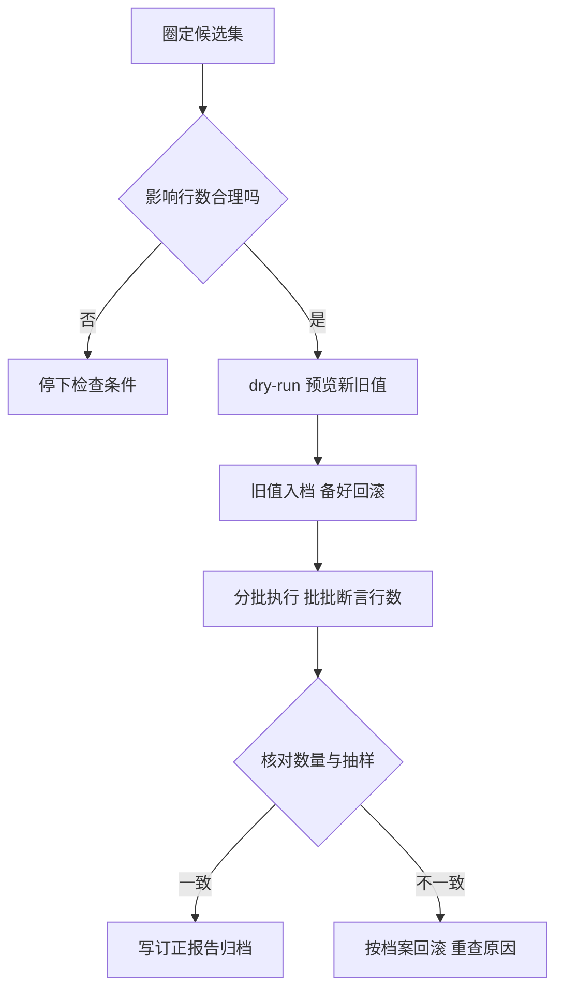

### Q2945 · 数据订正的标准流程: 检查 dry-run 执行 核对

> 难度:★★★☆ | 标签:数据订正, 运维

**问**:两千行订单的 region 字段填错了要批量订正,直接一条 UPDATE 干上去行吗?

**答**:不行,标准流程五步走。第一步检查:先用 SELECT 圈出候选集,影响行数与预期对不上就中止,影响面异常扩大是最常见的翻车点。第二步 dry-run:生成新旧值预览但不写一行,自己或业务方先看一眼改完长什么样。第三步入档:旧值先写进订正档案表,这是出问题后唯一能精准回滚的依据。第四步分批执行:每批一个短事务,批内用影响行数断言守门,行数不符立即回滚,绝不允许"以为改了其实没改"。第五步核对:残留数必须为零、档案条数必须等于订正数、抽样回查旧值对得上,全部通过才出订正报告。实测 133 行订正全程 6 毫秒,但流程的价值不在速度,在于每一步都留了后悔药。



```python
# file: code/04_数据库与缓存/q2945_data_correction_flow.py
"""数据订正标准流程: 检查 dry-run 入档 分批执行 核对 五步闭环"""
import sqlite3
import time

conn = sqlite3.connect(":memory:")
conn.row_factory = sqlite3.Row
conn.executescript("""
CREATE TABLE orders(id INTEGER PRIMARY KEY, region TEXT, amount REAL);
CREATE TABLE fix_log(oid INTEGER PRIMARY KEY, old_region TEXT,
                     new_region TEXT, at REAL);
""")
rows = []
for i in range(1, 2001):
    region = None if i % 15 == 0 else ("north", "south", "east")[i % 3]
    rows.append((i, region, round(i % 90 + 0.5, 2)))
conn.executemany("INSERT INTO orders VALUES(?,?,?)", rows)
conn.commit()

NEW_REGION = "north"

# 1) 检查: 先看清影响集, 行数异常直接中止
cand = conn.execute(
    "SELECT id, region FROM orders WHERE region IS NULL ORDER BY id").fetchall()
print("候选行数:", len(cand), "/ 总行数 2000")
assert len(cand) < 500, "影响面异常扩大, 中止"

# 2) dry-run: 只生成新值预览, 不写一行
preview = [(r["id"], r["region"], NEW_REGION) for r in cand[:3]]
print("dry-run 预览前 3 行:", preview)

# 3) 分批执行: 旧值入档与订正同事务, 每批断言影响行数
BATCH, done, t0 = 50, 0, time.perf_counter()
for i in range(0, len(cand), BATCH):
    ids = [r["id"] for r in cand[i:i + BATCH]]
    try:
        conn.execute("BEGIN IMMEDIATE")
        conn.execute(
            "INSERT INTO fix_log(oid, old_region, new_region, at) "
            "SELECT id, region, ?, ? FROM orders WHERE id IN (%s)"
            % ",".join("?" * len(ids)), [NEW_REGION, time.time()] + ids)
        cur = conn.execute(
            "UPDATE orders SET region=? WHERE id IN (%s)"
            % ",".join("?" * len(ids)), [NEW_REGION] + ids)
        assert cur.rowcount == len(ids), \
            "影响行数 %d != 预期 %d" % (cur.rowcount, len(ids))
        conn.commit()
        done += cur.rowcount
    except Exception:
        conn.rollback()
        raise
print("执行 %d 行, 耗时 %.1f ms" % (done, (time.perf_counter() - t0) * 1000))

# 4) 核对: 数量断言 + 档案回查 + 抽样旧值比对
left = conn.execute(
    "SELECT COUNT(*) FROM orders WHERE region IS NULL").fetchone()[0]
sample_id = cand[0]["id"]
log = conn.execute("SELECT old_region FROM fix_log WHERE oid=?",
                   (sample_id,)).fetchone()
assert left == 0 and done == len(cand) and log is not None
print("核对通过: 残留 0, 档案 %d 条, 抽样 id=%d 旧值=%s 可按档案回滚"
      % (conn.execute("SELECT COUNT(*) FROM fix_log").fetchone()[0],
         sample_id, log["old_region"]))
```

**追问**:
- 订正脚本本身要重入怎么办?—— 幂等条件天然支持重跑:region IS NULL 的行再跑一遍影响为零,档案表用 oid 做主键防重复入档。
- 和 dry-run 的单题 Q2509 差在哪?—— 那题只讲预览技术,本题补齐了入档、分批断言与核对三环,是完整可交付的流程。

---
