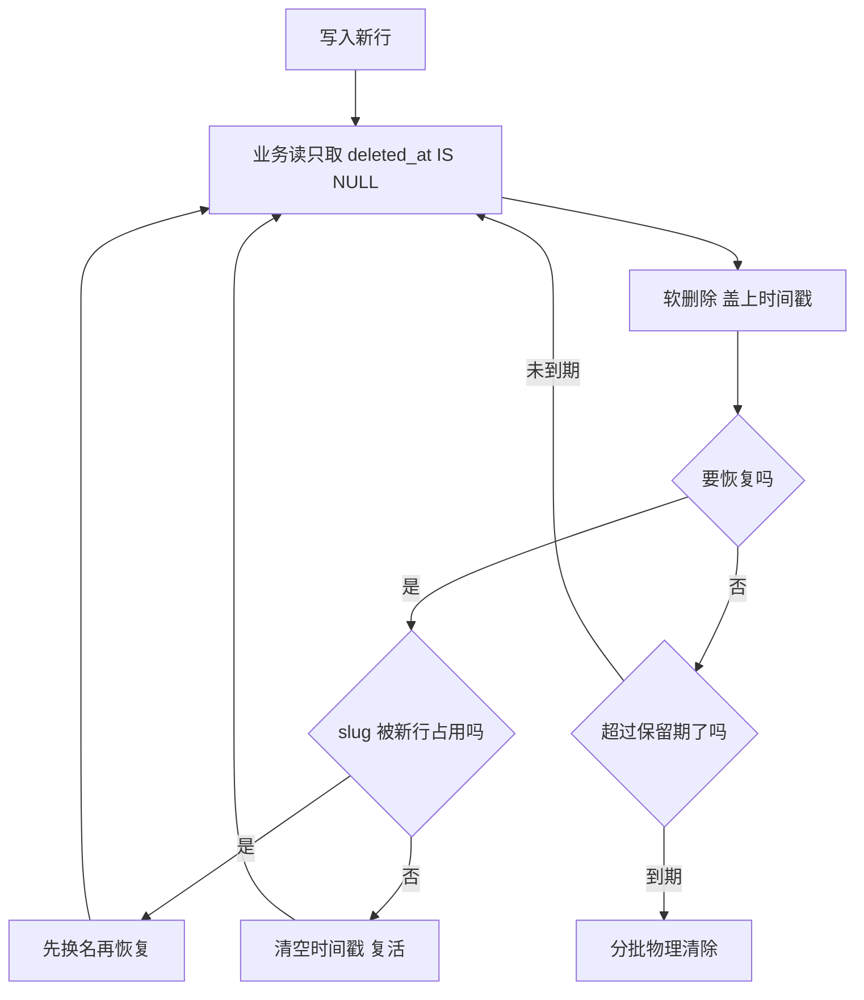

### Q2950 · 软删除的全链路: 写入 查询 恢复 清理

> 难度:★★★☆ | 标签:软删除, 数据生命周期

**问**:软删除不就是加个 deleted_at 字段吗,为什么总能听到"软删除出事故"?

**答**:字段谁都会加,事故出在链路不完整。完整链路四段:写入段,删除只是盖时间戳,行还在库里;查询段,所有业务读必须带 deleted_at IS NULL 过滤,漏一处就出现"已删数据诈尸";恢复段,直接清时间戳可能撞唯一约束——slug 被新行占用了,所以要配合部分唯一索引(只约束未删除行)并处理好换名恢复;清理段,超过保留期的行分批物理 DELETE 还空间,配合删除时间上的索引避免清理本身全表扫。实测完整走了一遍:软删后查询不可见、部分唯一索引允许同 slug 新建、直接恢复被约束拦下、换名恢复成功、过期行分批清掉,每一段都有确定性行为。



```python
# file: code/04_数据库与缓存/q2950_soft_delete_lifecycle.py
"""软删除全链路: 盖时间戳 查询过滤 恢复冲突 到期分批清除"""
import sqlite3
import time

conn = sqlite3.connect(":memory:")
conn.executescript("""
CREATE TABLE doc(id INTEGER PRIMARY KEY, slug TEXT NOT NULL,
                 title TEXT, deleted_at REAL);
CREATE UNIQUE INDEX uq_slug ON doc(slug) WHERE deleted_at IS NULL;
CREATE INDEX idx_doc_del ON doc(deleted_at);
""")


def add(slug, title):
    cur = conn.execute("INSERT INTO doc(slug, title) VALUES(?,?)", (slug, title))
    conn.commit()
    return cur.lastrowid


def get_live(slug):
    row = conn.execute(
        "SELECT id, slug, title FROM doc WHERE slug=? AND deleted_at IS NULL",
        (slug,)).fetchone()
    return dict(zip(("id", "slug", "title"), row)) if row else None


def soft_delete(slug):
    cur = conn.execute(
        "UPDATE doc SET deleted_at=? WHERE slug=? AND deleted_at IS NULL",
        (time.time(), slug))
    conn.commit()
    return cur.rowcount == 1


id1 = add("hello", "第一篇")
print("写入:", get_live("hello"))
print("软删除:", soft_delete("hello"), "-> 查询:", get_live("hello"))

# 部分唯一索引: 删除后 slug 释放, 同名可以再建
id2 = add("hello", "接力篇")
print("同 slug 再建成功, 新 id =", id2,
      "总行数(1 删 1 活):", conn.execute("SELECT COUNT(*) FROM doc").fetchone()[0])

# 直接恢复旧行会撞部分唯一索引(slug 被新行占用) -> 先换名再恢复
try:
    conn.execute("UPDATE doc SET deleted_at=NULL WHERE id=?", (id1,))
    conn.commit()
except sqlite3.IntegrityError as e:
    conn.rollback()
    print("直接恢复被唯一索引拦下:", e)
    conn.execute("UPDATE doc SET slug=?, deleted_at=NULL WHERE id=?",
                 ("hello-v1", id1))
    conn.commit()
    print("换名后恢复成功:", get_live("hello-v1"))

# 到期清理: 把 id1 的删除时间挪到 90 天前, 分批物理清除
conn.execute("UPDATE doc SET deleted_at=? WHERE id=?",
             (time.time() - 90 * 86400, id1))
conn.commit()
while True:
    cur = conn.execute(
        "DELETE FROM doc WHERE id IN "
        "(SELECT id FROM doc WHERE deleted_at IS NOT NULL "
        "AND deleted_at < ? LIMIT 1)",
        (time.time() - 30 * 86400,))
    conn.commit()
    if cur.rowcount == 0:
        break
print("过期清理后总行数:", conn.execute("SELECT COUNT(*) FROM doc").fetchone()[0])
```

**追问**:
- 怎么保证所有查询都不漏过滤条件?—— 收敛到 DAO 或视图层统一注入过滤,再配 Q929 的统一过滤姿势和代码评审门禁。
- 部分唯一索引和全列唯一索引选哪个?—— 软删表必须部分唯一,否则删除行会永远占住业务键,MySQL 没有 partial index 可用"删除时改写唯一列"的变通。

---
