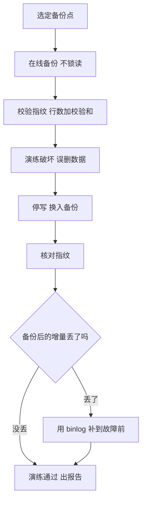

### Q2959 · 数据备份与恢复的演练脚本: 指纹校验与 RPO 实测

> 难度:★★★☆ | 标签:备份恢复, 演练

**问**:备份任务天天在跑绿勾,你怎么证明"这份备份真的能恢复"?

**答**:靠演练,而且演练要自动跑。流程五步:在线备份——用 SQLite 的 backup API(生产对应 xtrabackup/快照)在业务读写不中断时拷出副本;校验指纹——对备份库算行数与 id 校验和,和源库比对,证明备份完整;制造灾难——模拟误操作清空全表;恢复——停写、备份文件顶上、重开连接;核对与量化——指纹与备份点一致即恢复成功,同时量出 RTO(恢复耗时)和 RPO(备份点之后丢失的增量,实测丢了备份后新写的 10 行)。演练的价值在暴露两个常被忽略的事实:恢复耗时必须实测而不是猜;备份点之后的增量就是 RPO 损失,生产必须靠 binlog 增量把这段补齐,光有全量备份的 RPO 是"上次备份到故障"那么长。



```python
# file: code/04_数据库与缓存/q2959_backup_restore_drill.py
"""备份恢复演练: 在线备份 指纹校验 灾难恢复 RPO 损失实测"""
import os
import shutil
import sqlite3
import tempfile
import time

work = tempfile.mkdtemp(prefix="drill_")
main_db, bak_db = os.path.join(work, "main.db"), os.path.join(work, "bak.db")

conn = sqlite3.connect(main_db)
conn.execute("CREATE TABLE t(id INTEGER PRIMARY KEY, v TEXT)")
conn.executemany("INSERT INTO t(v) VALUES(?)",
                 [("v%d" % i,) for i in range(1, 5001)])
conn.commit()

# 1) 在线备份: backup API 不阻断业务读写
t0 = time.perf_counter()
dst = sqlite3.connect(bak_db)
conn.backup(dst)
dst.close()
backup_ms = (time.perf_counter() - t0) * 1000


def fingerprint(path):
    c = sqlite3.connect(path)
    fp = c.execute("SELECT COUNT(*), SUM(id) FROM t").fetchone()
    c.close()
    return fp


base = fingerprint(bak_db)
print("备份 %d 行耗时 %.0f ms, 指纹(行数, id总和) = %s"
      % (base[0], backup_ms, base))
assert fingerprint(main_db) == base, "备份必须与源一致"

# 2) 备份点之后业务继续写入 10 行 —— 这就是潜在 RPO 损失
conn.executemany("INSERT INTO t(v) VALUES(?)",
                 [("late%d" % i,) for i in range(10)])
conn.commit()
print("备份后新增 10 行, 当前总行数:",
      conn.execute("SELECT COUNT(*) FROM t").fetchone()[0])

# 3) 灾难: 误操作清空全表
conn.execute("DELETE FROM t")
conn.commit()
print("灾难发生: 主库行数 =",
      conn.execute("SELECT COUNT(*) FROM t").fetchone()[0])

# 4) 恢复: 停写 -> 备份顶上 -> 核对指纹
t0 = time.perf_counter()
conn.close()
shutil.copyfile(bak_db, main_db)
conn = sqlite3.connect(main_db)
restored = fingerprint(main_db)
rto_ms = (time.perf_counter() - t0) * 1000
print("恢复完成, 指纹: %s, RTO 约 %.0f ms" % (restored, rto_ms))
assert restored == base
print("RPO 损失 = 备份点之后的 10 行 (生产要用 binlog 增量把这段补齐)")
conn.close()
shutil.rmtree(work)
print("演练通过: 备份可恢复, 恢复可校验, 损失可量化")
```

**追问**:
- 恢复演练会不会影响生产?—— 在隔离环境对备份副本做恢复,生产库只出样本指纹,演练频率进常规巡检,见 Q1966 的清单与自动验证。
- 全量加增量的保留策略怎么定?—— 日七周四月三的三代轮换兼顾恢复点与成本,见 Q2783 与 Q880 的 PITR。
