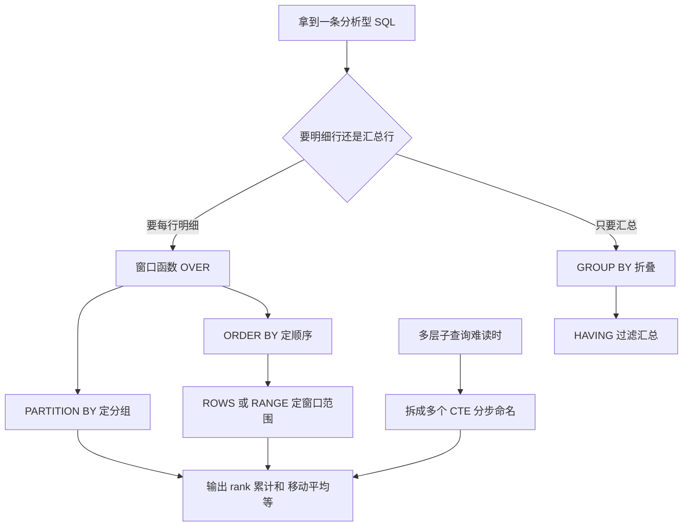

### Q860 · 递归 CTE: 树形结构与层级展开

> 难度:★★★★ | 标签:SQL, 递归 CTE

**问**:员工表只有 manager_id,如何一条 SQL 查出某人的整条汇报链?递归 CTE 的执行过程是什么?

**答**:递归 CTE 由"锚点查询"(起点,如 CEO 或指定员工)加"递归查询"(基于上轮结果继续下钻,通常 `JOIN cte ON 子表.父键 = cte.子键`)构成,用 UNION ALL 连接,数据库循环执行递归部分直到返回空集。可以携带 depth 计数、path 字符串来辅助展示层级与防环。两个工程要点:一是 UNION ALL 比 UNION 少一次去重,树结构没有重复行时用它更快;二是必须在业务上保证有终止条件(树不能有环),必要时在递归里限制 depth 上限防止死循环。

```python
# file: code/04_数据库与缓存/q860_recursive_cte.py
"""递归 CTE 沿 manager_id 展开组织树, 携带层级与路径"""
import sqlite3

DDL = """
CREATE TABLE emp (id INTEGER PRIMARY KEY, name TEXT, manager_id INTEGER);
INSERT INTO emp VALUES
 (1,'ceo',NULL),(2,'cto',1),(3,'cfo',1),
 (4,'dev1',2),(5,'dev2',2),(6,'qa1',2),(7,'acc1',3);
"""

SQL = """
WITH RECURSIVE chain AS (
  SELECT id, name, manager_id, 1 AS depth, name AS path
  FROM emp WHERE name = 'ceo'
  UNION ALL
  SELECT e.id, e.name, e.manager_id, c.depth + 1, c.path || '->' || e.name
  FROM emp e JOIN chain c ON e.manager_id = c.id
)
SELECT depth, path FROM chain ORDER BY path
"""

if __name__ == "__main__":
    with sqlite3.connect(":memory:") as conn:
        conn.executescript(DDL)
        for depth, path in conn.execute(SQL):
            print(f"depth={depth}  {path}")
```

**追问**:
- 想查"某人所有下属"和"所有上级"分别怎么改?——锚点换成该员工、递归条件换成 `e.id = c.manager_id` 向上找,向下则是 `e.manager_id = c.id`。
- 树特别深会怎样?——每层都是一轮循环,深度大时轮次多,必要时在应用层缓存子树或改用物化路径/闭包表存储。

---



---
