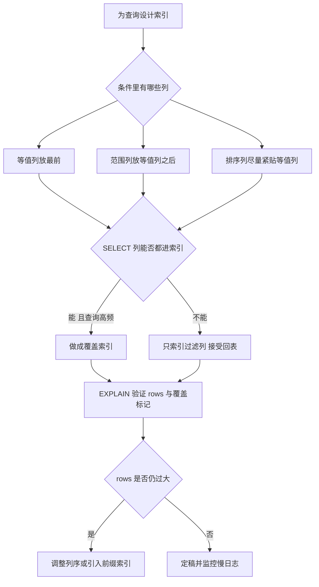

### Q865 · 覆盖索引实战: 让查询不回表

> 难度:★★★☆ | 标签:索引, 覆盖索引

**问**:什么是覆盖索引?如何确认查询用了覆盖索引?设计时要注意什么?

**答**:当查询所需的所有列(含 WHERE、ORDER BY、SELECT)都在某个二级索引里时,无需回聚簇索引取行,称为覆盖索引,SQLite 计划里显示 `USING COVERING INDEX`,MySQL Extra 显示 `Using index`。设计方法是把高频查询的 SELECT 列追加进联合索引尾部(如 `(user_id, status, created_at)` 服务 `WHERE user_id=? AND status=? ORDER BY created_at` 取 created_at 的场景)。注意权衡:每加一列索引就变大、写入变慢,只对高频核心查询做覆盖;避免 `SELECT *`,它几乎不可能被覆盖。

```python
# file: code/04_数据库与缓存/q865_covering_index.py
"""构造查询验证覆盖索引: 计划出现 USING COVERING INDEX 即免回表"""
import sqlite3

if __name__ == "__main__":
    with sqlite3.connect(":memory:") as conn:
        conn.execute("""CREATE TABLE orders (
            id INTEGER PRIMARY KEY, user_id INT, status TEXT, created_at TEXT)""")
        conn.executemany("INSERT INTO orders (user_id, status, created_at) VALUES (?,?,?)",
                         [(i % 100, "paid" if i % 3 else "new", f"2024-{i % 12 + 1:02d}")
                          for i in range(20000)])

        sql = ("SELECT created_at FROM orders "
               "WHERE user_id = 7 AND status = 'paid' ORDER BY created_at")

        conn.execute("CREATE INDEX idx_user_status ON orders (user_id, status)")
        p1 = conn.execute("EXPLAIN QUERY PLAN " + sql).fetchall()
        print("普通索引:", [r[3] for r in p1])

        conn.execute("DROP INDEX idx_user_status")
        conn.execute("CREATE INDEX idx_cover ON orders (user_id, status, created_at)")
        p2 = conn.execute("EXPLAIN QUERY PLAN " + sql).fetchall()
        print("覆盖索引:", [r[3] for r in p2])
```

**追问**:
- 覆盖索引还要回表吗?——不需要,这正是它的意义;只有 SELECT 列超出索引范围时才回表。
- 为什么 SELECT * 是覆盖索引杀手?——所有列都要取,二级索引不含全部列,必然回表,常常还让优化器直接放弃该索引。

---



---
