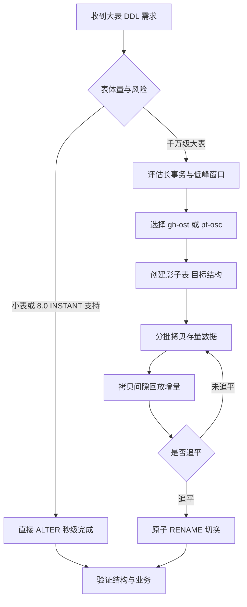

### Q870 · gh-ost 与 pt-osc: 大表改表工具原理

> 难度:★★★★ | 标签:DDL, gh-ost

**问**:gh-ost 和 pt-online-schema-change 的核心原理是什么?两者差异在哪?

**答**:共同套路是"影子表 + 增量回放 + 原子改名":按目标结构建 `_new` 影子表,分批把原表数据拷过去,同时持续把增量应用到影子表,最后用一次原子 RENAME TABLE 切换,整个过程原表可正常读写。差异在增量来源:pt-osc 用触发器捕获增量,触发器在原表上实时执行,有额外写放大;gh-ost 不用触发器,伪装成从库消费 binlog 回放,对主库更轻,还支持限速、暂停与动态控制,已是更主流的选择。风险点:外键/触发器表不支持、改名瞬间元数据锁、切换失败要有回滚预案。

```python
# file: code/04_数据库与缓存/q870_ghost_sim.py
"""用纯逻辑模拟 gh-ost 三阶段: 建影子表 分批拷贝 回放增量 原子切换"""
import itertools

def migrate(rows, changelog, batch=2):
    # 1) 影子表: 结构即目标结构, 这里直接用列表模拟
    shadow = {}
    source = dict(rows)
    for i in range(0, len(source), batch):
        for k in itertools.islice(source.keys(), i, i + batch):
            shadow[k] = source[k] + "_migrated"          # 模拟结构转换
        # 2) 拷贝间隙回放 binlog 增量
        for op, k, v in changelog[:]:
            if k not in shadow:
                shadow[k] = v + "_migrated"
                changelog.remove(op and (op, k, v))
        print(f"已拷贝 {min(i + batch, len(source))} 行, 影子表 {len(shadow)} 行")
    # 3) 原子切换: 真实 gh-ost 是 RENAME TABLE 原表与影子表互换
    return shadow

if __name__ == "__main__":
    rows = [(k, f"row{k}") for k in range(1, 7)]
    changelog = [("insert", 7, "row7")]
    result = migrate(rows, changelog)
    print("切换后新表:", result)
```

**追问**:
- 为什么最后切换要原子 RENAME 而不是先删旧表?——RENAME 一条语句完成新旧互换,业务无感知窗口;先删后建会出现表不存在的时间窗。
- 影子表期间数据一直变化,如何保证最终一致?——拷贝完成前 binlog 持续回放,拷贝追平后短暂停止写入流量完成切换,由工具保证时序。

---


