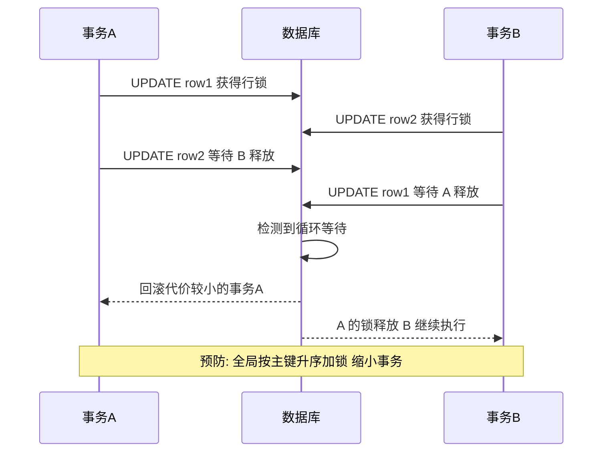

### Q875 · 死锁案例分析: 加锁顺序不一致

> 难度:★★★☆ | 标签:死锁, 事务

**问**:转账 A 给 B 与 B 给 A 并发,为什么会死锁?最实用的预防手段是什么?

**答**:两个事务按相反顺序 UPDATE 两行:A 先锁 1 后等 2,B 先锁 2 后等 1,互相持有对方需要的行锁,经典"循环等待"。Coffman 四条件里"循环等待"最容易被破坏——规定全局加锁顺序(如永远按主键升序处理账户),所有事务一致遵守,即可结构性消除此类死锁。配合手段还有:缩小事务范围、把批量更新按主键排序后执行、降低隔离级别、依赖 InnoDB 死锁检测(默认开启)并让应用对死锁错误(1213)做指数退避重试。

```python
# file: code/04_数据库与缓存/q875_lock_order.py
"""双线程按不同顺序更新两行触发 SQLITE_BUSY, 再用统一顺序修复"""
import sqlite3
import threading

def setup():
    conn = sqlite3.connect("q875_demo.db", isolation_level=None)
    conn.execute("PRAGMA busy_timeout=300")
    conn.execute("CREATE TABLE IF NOT EXISTS acct (id INT PRIMARY KEY, bal INT)")
    conn.execute("DELETE FROM acct")
    conn.executemany("INSERT INTO acct VALUES (?, ?)", [(1, 100), (2, 100)])
    return conn

def transfer(conn, src, dst, amt, expect_fail):
    try:
        conn.execute("BEGIN IMMEDIATE")
        conn.execute("UPDATE acct SET bal = bal - ? WHERE id = ?", (amt, src))
        conn.execute("UPDATE acct SET bal = bal + ? WHERE id = ?", (amt, dst))
        conn.execute("COMMIT")
        print(f"转账 {src}->{dst} 成功")
    except sqlite3.OperationalError as e:
        conn.execute("ROLLBACK")
        print(f"转账 {src}->{dst} 失败: {e}" + ("" if expect_fail else " 不应发生"))

if __name__ == "__main__":
    setup()
    c1, c2 = sqlite3.connect("q875_demo.db"), sqlite3.connect("q875_demo.db")
    for c in (c1, c2):
        c.execute("PRAGMA busy_timeout=300")
    # 反序: 线程1 走 1->2, 线程2 走 2->1, 高概率一方等待超时
    t1 = threading.Thread(target=transfer, args=(c1, 1, 2, 10, True))
    t2 = threading.Thread(target=transfer, args=(c2, 2, 1, 10, True))
    t1.start(); t2.start(); t1.join(); t2.join()
    # 修复: 两个方向都按主键升序锁定
    transfer(c1, *sorted((1, 2)), 10, False)
    transfer(c2, *sorted((2, 1)), 10, False)
    print("最终余额:", c1.execute("SELECT * FROM acct").fetchall())
```

**追问**:
- 死锁检测和锁等待超时什么关系?——InnoDB 默认开启死锁检测主动回滚代价小的事务;关闭后靠 innodb_lock_wait_timeout 超时,高并发热点下检测本身也有 CPU 成本。
- 批量更新怎么防死锁?——先 ORDER BY 主键再逐条更新,保证所有事务的加锁路径一致。

---



---
