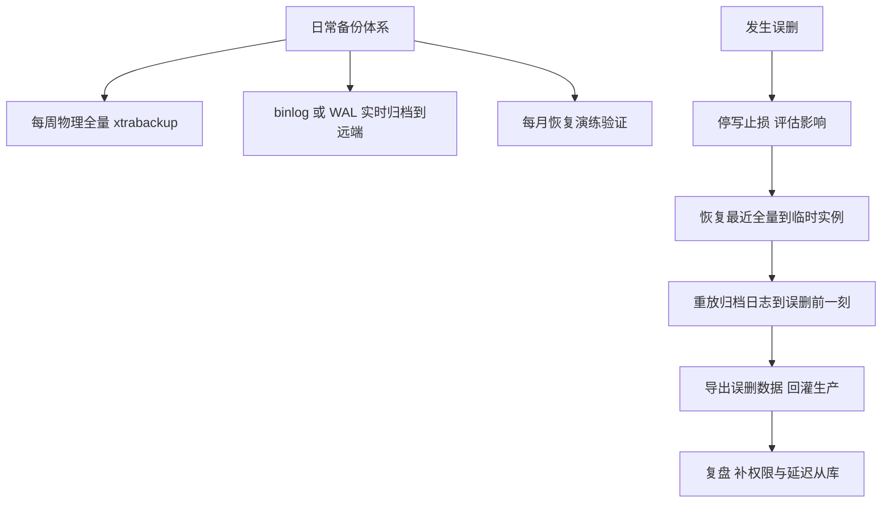

### Q880 · 备份与恢复: 全量加增量到 PITR

> 难度:★★★★ | 标签:备份, 运维

**问**:数据库备份怎么做?误删数据后如何恢复到指定时间点?

**答**:标准组合是"周期性物理/逻辑全量备份 + 连续的 binlog/WAL 归档",恢复到任意时刻(PITR)的流程:先恢复最近一次全量,再从该备份对应位点开始重放 binlog 到目标时刻(误删语句之前),必要时用 `--start-datetime` 或 GTID 区间控制。工程要求:备份异机异地存储、定期做恢复演练(没演练过的备份等于没有)、用 xtrabackup 等物理备份工具保证大库速度与一致性、mysqldump 记得 `--single-transaction` 获得一致性快照。SQLite 教学场景里 `conn.backup()` 演示在线备份语义:备份期间源库可继续读写。

```python
# file: code/04_数据库与缓存/q880_backup_restore.py
"""sqlite3 在线备份 + 重放操作日志, 模拟 PITR 恢复思路"""
import sqlite3

if __name__ == "__main__":
    src = sqlite3.connect("q880_src.db")
    src.execute("CREATE TABLE IF NOT EXISTS ops (id INTEGER PRIMARY KEY, cmd TEXT)")
    src.execute("DELETE FROM ops")
    src.commit()                          # 备份前提交, 避免备份与未决事务冲突

    dest = sqlite3.connect("q880_bak.db")
    src.backup(dest)                      # 全量快照, 期间源库仍可写
    src.execute("INSERT INTO ops (cmd) VALUES ('delete_user')")
    src.commit()
    print("备份后源库新增了一条危险操作")

    # 恢复: 不重放危险操作, 只恢复到备份点
    restored = sqlite3.connect("q880_bak.db")
    print("恢复库 ops 行数:", restored.execute("SELECT COUNT(*) FROM ops").fetchone()[0])
    print("源库 ops 行数:", src.execute("SELECT COUNT(*) FROM ops").fetchone()[0])
    src.close(); dest.close(); restored.close()
```

**追问**:
- 逻辑备份和物理备份怎么选?——逻辑备份(mysqldump)可读可跨版本但大库慢;物理备份(xtrabackup)快、支持增量,常与 binlog 归档组合。
- 只有全量备份能恢复误删吗?——只能回到备份点;要恢复到误删前一秒必须依赖 binlog/WAL 增量重放,这也是 binlog 不能只保留 1 天的原因。

---



---
