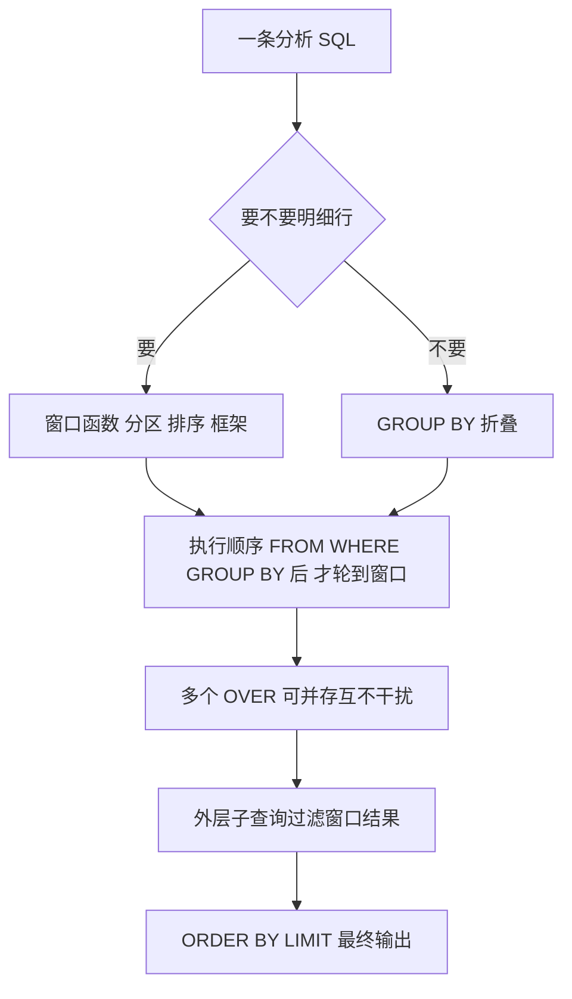

### Q885 · 窗口函数综合报表: 排名、占比、累计一步到位

> 难度:★★★★ | 标签:窗口函数, 综合案例

**问**:一条 SQL 同时给出每人销售额、类目内排名、占类目比重、全表累计,怎么写?

**答**:这正是窗口函数的主场:RANK() OVER (PARTITION BY category ORDER BY amt DESC) 得类目内名次;amt / SUM(amt) OVER (PARTITION BY category) 得占比——注意分母用了"只有 PARTITION 无 ORDER BY"的聚合窗口,对全分区求和;SUM(amt) OVER (ORDER BY seq ROWS UNBOUNDED PRECEDING) 得全表按时间累计。一个查询里多个窗口定义互不冲突,SQLite/MySQL 8/PG 都支持。这类题考察的是"窗口函数与 GROUP BY 不互斥、窗口在聚合后计算"的执行顺序理解。

```python
# file: code/04_数据库与缓存/q885_window_report.py
"""多窗口叠加: 类目排名 + 类目占比 + 全表累计 一条 SQL 完成"""
import sqlite3

if __name__ == "__main__":
    with sqlite3.connect(":memory:") as conn:
        conn.execute("CREATE TABLE sales (name TEXT, category TEXT, amt REAL, seq INT)")
        conn.executemany("INSERT INTO sales VALUES (?,?,?,?)", [
            ("A", "book", 100, 1), ("B", "book", 70, 2), ("C", "toy", 80, 3),
            ("D", "toy", 80, 4), ("E", "book", 30, 5)])

        sql = """
        SELECT name, category, amt,
               RANK() OVER (PARTITION BY category ORDER BY amt DESC) AS rk,
               ROUND(amt * 1.0 / SUM(amt) OVER (PARTITION BY category), 3) AS share,
               SUM(amt) OVER (ORDER BY seq ROWS UNBOUNDED PRECEDING) AS running
        FROM sales ORDER BY seq
        """
        print(f"{'name':<5}{'cat':<6}{'amt':<6}{'rk':<3}{'share':<7}{'running'}")
        for row in conn.execute(sql):
            print(f"{row[0]:<5}{row[1]:<6}{row[2]:<6.0f}{row[3]:<3}{row[4]:<7.3f}{row[5]:.0f}")
```

**追问**:
- 窗口函数与 GROUP BY 能同用吗?——能,GROUP BY 先折叠,窗口函数在折叠后的结果上计算,窗口里引用的是聚合后的列。
- 占比分母为什么不能直接 SUM(amt)?——裸 SUM 是聚合语义需要 GROUP BY,加 OVER (PARTITION BY category) 才变成"逐行返回分区内总和"的窗口聚合。

---



---
