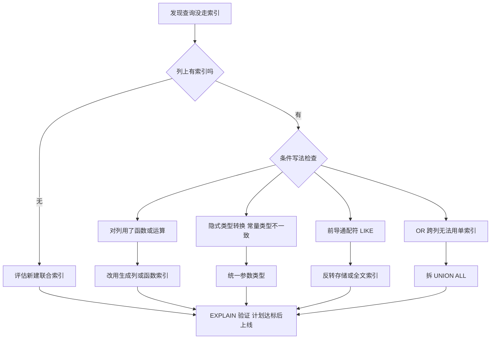

### Q895 · 隐式类型转换: 索引失效的隐形杀手

> 难度:★★★☆ | 标签:类型转换, 索引

**问**:字符串列用数字去查会发生什么?MySQL 的隐式转换规则是什么?

**答**:MySQL 规则:字符串列与数字比较时,把"列"转成数字(MySQL 的类型转换优先级是数字 > 字符串),于是 `'123abc'`、`' 123'` 都会参与逐行计算,索引上的有序性失效,退化为全表扫描;反过来数字列用字符串查则会把常量转换,索引仍然可用。所以原则是"常量类型向列看齐,别让列去转换"。另外隐式转换还会带来比较错误:`'1a' = 1` 为真、身份证/手机号字符串尾缀精度问题(转 float 丢精度)。SQLite 情形不同:TEXT 列与整数比较按亲和性规则先把常量转成文本,索引仍可用——但也不能依赖,建议统一参数类型。

```python
# file: code/04_数据库与缓存/q895_type_conversion.py
"""演示 sqlite TEXT 亲和性下的类型转换行为, 并说明 MySQL 的相反规则"""
import sqlite3

if __name__ == "__main__":
    with sqlite3.connect(":memory:") as conn:
        conn.execute("CREATE TABLE t (phone TEXT)")
        conn.executemany("INSERT INTO t VALUES (?)",
                         [("13800000001",), ("13800000002",), ("bad_data",)])
        conn.execute("CREATE INDEX idx_phone ON t (phone)")

        plan_int = conn.execute("EXPLAIN QUERY PLAN SELECT * FROM t WHERE phone = ?",
                                (13800000001,)).fetchall()
        plan_str = conn.execute("EXPLAIN QUERY PLAN SELECT * FROM t WHERE phone = ?",
                                ("13800000001",)).fetchall()
        print("整型参数:", [r[3] for r in plan_int])
        print("字符串参数:", [r[3] for r in plan_str])
        print("MySQL 对照: TEXT 列 + 数字常量 -> 列转数字, 索引失效全表扫描")
        print("稳妥做法: 查询参数类型与列定义一致", conn.execute(
            "SELECT * FROM t WHERE phone = ?", ("13800000002",)).fetchall())
```

**追问**:
- 为什么数字列用字符串查不受影响?——MySQL 把常量转成数字后仍是等值比较,列本身未参与转换,索引保持有序。
- 这类问题怎么在上线前发现?——Code review 检查参数类型 + 慢日志观察 type=ALL 的意外全表扫 + 对外接口统一 DTO 类型。

---



---
