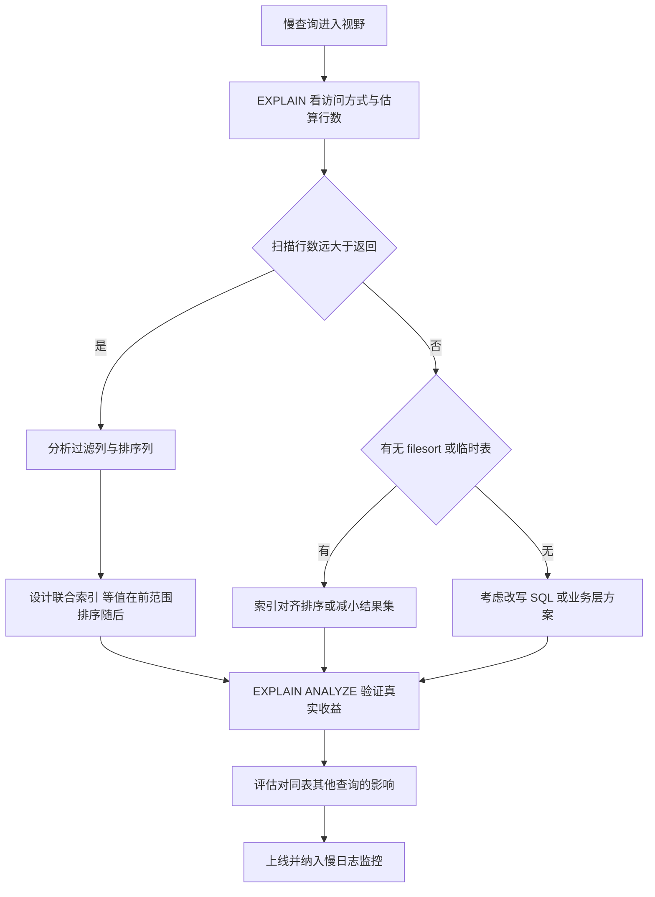

### Q900 · SQL 调优综合案例: 从 8 秒到 80 毫秒

> 难度:★★★★★ | 标签:调优, 综合案例

**问**:一条 `SELECT ... WHERE user_id=? AND status=? ORDER BY created_at DESC LIMIT 20` 要 8 秒,给出完整调优过程。

**答**:标准五步:一、EXPLAIN 看访问方式,常见结论是全表扫描或走了 (user_id) 单列索引后对海量结果 filesort;二、计算扫描与返回比,10 万行换 20 行,问题在"过滤+排序"没有索引支撑;三、设计联合索引 `(user_id, status, created_at)`:等值等值排序全对齐,直接按序取前 20 条,若 SELECT 列少再扩成覆盖索引;四、验证 EXPLAIN 类型到 range/const 且无 filesort,EXPLAIN ANALYZE 确认实际行数接近估算;五、回归检查同表其他查询是否受益或受损(索引不是免费的),纳入慢日志持续观察。整个过程体现方法论:先测量、再假设、用计划验证,而不是凭感觉加索引。

```python
# file: code/04_数据库与缓存/q900_tuning_case.py
"""完整调优演示: 单列索引 + filesort 优化为三列联合索引直取"""
import sqlite3
import time

if __name__ == "__main__":
    with sqlite3.connect(":memory:") as conn:
        conn.execute("""CREATE TABLE orders (id INTEGER PRIMARY KEY,
                        user_id INT, status TEXT, created_at INT)""")
        conn.executemany("INSERT INTO orders (user_id, status, created_at) VALUES (?,?,?)",
                         [(i % 200, "paid" if i % 4 else "new", i)
                          for i in range(200000)])
        conn.execute("CREATE INDEX idx_user ON orders (user_id)")

        sql = ("SELECT id, created_at FROM orders "
               "WHERE user_id = 7 AND status = 'paid' "
               "ORDER BY created_at DESC LIMIT 20")

        t0 = time.perf_counter()
        conn.execute(sql).fetchall()
        slow = (time.perf_counter() - t0) * 1000
        plan_slow = conn.execute("EXPLAIN QUERY PLAN " + sql).fetchall()

        conn.execute("DROP INDEX idx_user")
        conn.execute("CREATE INDEX idx_best ON orders (user_id, status, created_at)")
        t1 = time.perf_counter()
        conn.execute(sql).fetchall()
        fast = (time.perf_counter() - t1) * 1000
        plan_fast = conn.execute("EXPLAIN QUERY PLAN " + sql).fetchall()

        print("优化前计划:", [r[3] for r in plan_slow], f"{slow:.1f} ms")
        print("优化后计划:", [r[3] for r in plan_fast], f"{fast:.1f} ms")
```

**追问**:
- 为什么 `(user_id, status, created_at)` 能同时消除过滤和排序?——两列等值定位后,created_at 在索引内仍有序,倒序扫描即可直接 LIMIT,不需要排序步骤。
- 如果 status 列还要支持单独查询呢?——加 `(status, created_at)` 索引服务单列场景,索引按查询组合设计,不存在万能索引。

---



---
