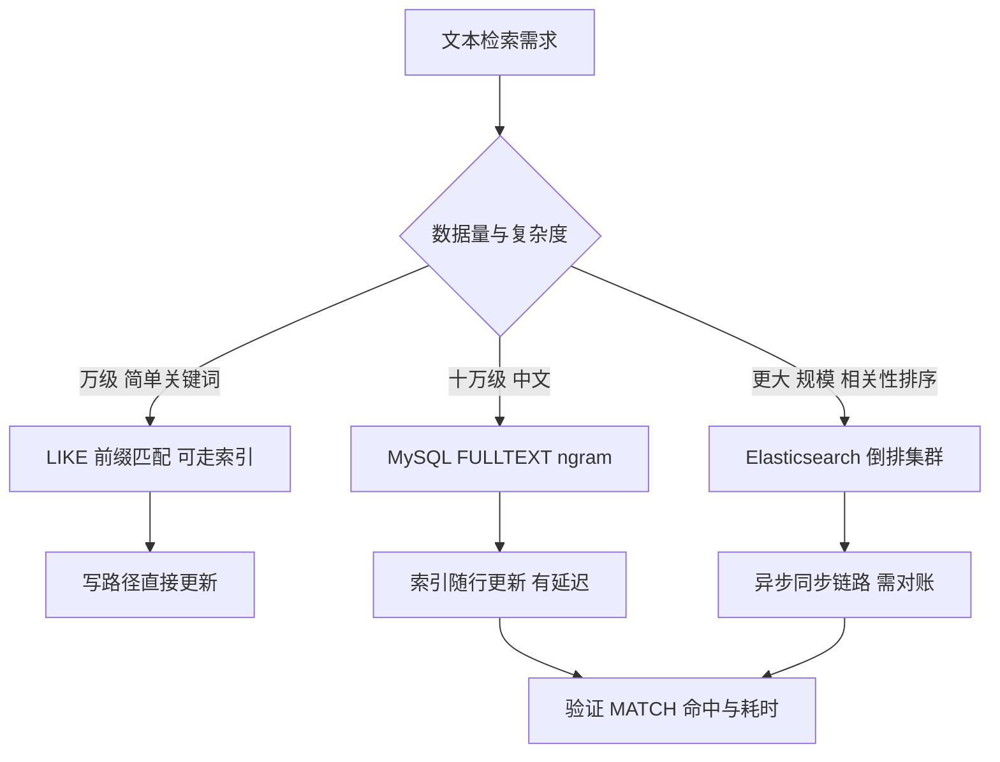

### Q905 · 全文索引: FTS5 与倒排原理

> 难度:★★★☆ | 标签:全文索引, SQLite

**问**:LIKE '%关键词%' 为什么用不上索引?全文索引是怎么解决的?

**答**:前导通配符使 B+ 树无法定位前缀,只能全表逐行 substring 匹配。全文索引走倒排结构:分词后为每个词维护"词 -> 文档列表"的映射,查询先查词表再取文档列表合并,复杂度与结果集相关而非数据总量。SQLite 内置 FTS5 虚拟表,`CREATE VIRTUAL TABLE t USING fts5(content)` 后用 `MATCH '关键词'` 查询;MySQL 有 FULLTEXT 索引(ngram 分词支持中文),大数据量与复杂检索则交给 Elasticsearch。注意中文分词、相关性排序(BM25)、索引同步延迟这三点是面试常追问的落地细节。

```python
# file: code/04_数据库与缓存/q905_fts5_demo.py
"""sqlite FTS5 全文索引: 建虚拟表 插入检索 与 LIKE 性能对比"""
import sqlite3
import time

if __name__ == "__main__":
    with sqlite3.connect(":memory:") as conn:
        docs = [(f"第{i}篇 python 数据库与缓存 调优 文章内容{i % 7}",)
                for i in range(20000)]
        conn.execute("CREATE TABLE docs (content TEXT)")
        conn.executemany("INSERT INTO docs VALUES (?)", docs)

        try:
            conn.execute("CREATE VIRTUAL TABLE fts USING fts5(content)")
            conn.executemany("INSERT INTO fts VALUES (?)", docs)

            t0 = time.perf_counter()
            r1 = conn.execute("SELECT count(*) FROM docs WHERE content LIKE '%文章内容3%'").fetchone()
            t1 = time.perf_counter()
            r2 = conn.execute("SELECT count(*) FROM fts WHERE fts MATCH '文章内容3'").fetchone()
            t2 = time.perf_counter()
            print(f"LIKE: {r1[0]} 行 {(t1-t0)*1000:.1f} ms")
            print(f"FTS5 MATCH: {r2[0]} 行 {(t2-t1)*1000:.1f} ms")
        except sqlite3.OperationalError as e:
            print("当前 sqlite 编译未含 FTS5:", e)
```

**追问**:
- FTS5 怎么支持中文?——默认 unicode61 按空格分词对中文无效,需自定义分词器或按字切分,生产中文检索一般用 ES+ngram/IK。
- 全文索引什么时候失效更新?——FTS5 是独立虚拟表需同步插入删除,外部表内容触发器或 triggers 同步,否则检索结果陈旧。

---


