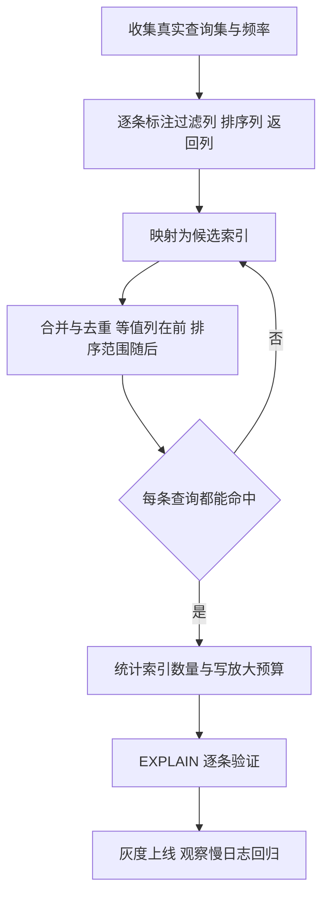

### Q910 · 索引设计综合案例: 一套查询集的索引方案

> 难度:★★★★★ | 标签:索引, 综合案例

**问**:订单表高频查询有五类:按订单号查详情、按用户查近期订单、商家维度的状态统计、待支付超时扫描、按时间导出。给出索引方案并论证取舍。

**答**:逐条映射:订单号是唯一业务键,唯一索引 `(order_no)`(或直接做主键);用户维度 `(user_id, created_at)` 服务"该用户按时间倒序一页页取";商家状态统计 `(merchant_id, status, created_at)`——等值+等值+排序/范围;超时扫描 `(status, expire_at)` 让定时任务 `WHERE status='pending' AND expire_at < now` 精准切片,避免全表;导出场景走 `created_at` 单列或直接依赖聚簇主键+分片扫描,低频不必额外建索引。取舍原则:每个索引都要有明确查询认领;写多读少的表控制索引数量;验证手段统一为 EXPLAIN 逐条过计划,再观察慢日志回归。

```python
# file: code/04_数据库与缓存/q910_index_design_case.py
"""订单表五类高频查询的索引方案与逐条 EXPLAIN 验证"""
import sqlite3

if __name__ == "__main__":
    with sqlite3.connect(":memory:") as conn:
        conn.execute("""CREATE TABLE orders (
            id INTEGER PRIMARY KEY, order_no TEXT UNIQUE,
            user_id INT, merchant_id INT, status TEXT,
            expire_at INT, created_at INT)""")
        conn.executemany(
            "INSERT INTO orders (order_no, user_id, merchant_id, status, expire_at, created_at) "
            "VALUES (?, ?, ?, ?, ?, ?)",
            [(f"NO{i:07d}", i % 1000, i % 50, ["pending", "paid", "done"][i % 3],
              1700000000 + i % 3600, 1700000000 + i) for i in range(50000)])

        conn.executescript("""
            CREATE INDEX idx_user_time    ON orders (user_id, created_at);
            CREATE INDEX idx_mch_status   ON orders (merchant_id, status, created_at);
            CREATE INDEX idx_status_exp   ON orders (status, expire_at);
        """)

        queries = {
            "订单号详情": "SELECT * FROM orders WHERE order_no = 'NO0000123'",
            "用户近期订单": "SELECT * FROM orders WHERE user_id = 7 "
                            "ORDER BY created_at DESC LIMIT 20",
            "商家状态统计": "SELECT count(*) FROM orders "
                            "WHERE merchant_id = 3 AND status = 'paid'",
            "超时扫描": "SELECT id FROM orders WHERE status = 'pending' "
                        "AND expire_at < 1700000100",
        }
        for name, sql in queries.items():
            plan = conn.execute("EXPLAIN QUERY PLAN " + sql).fetchall()
            uses_index = any("USING INDEX" in r[3] or "USING" in r[3] for r in plan)
            print(f"{name}: 走索引={uses_index}  {[r[3] for r in plan]}")
```

**追问**:
- 五个索引会不会太多?——本例四个索引都各司其职,是否合并要拿真实查询频率加权;无法服务的索引直接删掉。
- 为什么导出不单独建索引?——低频管理任务可以接受较慢的批量扫描,而多一个索引全体写入都要买单,成本收益不成立。

---


