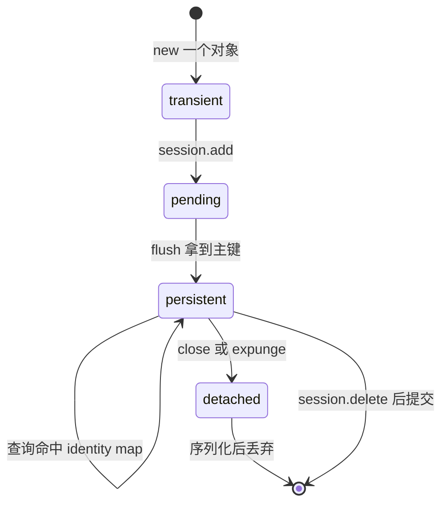

### Q915 · expunge / detach 与 commit 顺序: 对象出层的正确姿势

> 难度:★★★★ | 标签:SQLAlchemy, Session

**问**:commit 之后对象为什么"失明"?想安全地把 ORM 对象传给其他层怎么办?

**答**:默认 expire_on_commit=True,commit 后所有属性被标记过期,下次访问任意属性会隐式开新事务回查——在已 close 的 session 上就是 DetachedInstanceError,在长连接上是意外的额外查询。出层策略三种:一、session 内完成全部属性访问再关闭;二、`session.expunge(obj)` 主动卸载(先确保属性已加载,或配合 refresh);三、常见工程配置 `expire_on_commit=False`,commit 后属性保持可读,代价是放弃"commit 后自动反映 DB 默认值"的新鲜度。顺序纪律:先 flush 拿到主键、再 commit、最后访问/序列化,序列化应转 DTO 而非 ORM 对象满天飞。

```python
# file: code/04_数据库与缓存/q915_expunge_commit.py
"""对比 expire_on_commit 两种设置与 expunge 的对象出层行为"""

try:
    from sqlalchemy import create_engine
    from sqlalchemy.orm import Session, DeclarativeBase, Mapped, mapped_column
except ImportError:
    print("该题演示需要第三方库 sqlalchemy:pip install sqlalchemy>=2.0,原理见正文")
    raise SystemExit(0)

class Base(DeclarativeBase):
    pass

class User(Base):
    __tablename__ = "users"
    id: Mapped[int] = mapped_column(primary_key=True)
    name: Mapped[str]

def demo(expire_on_commit, use_expunge):
    engine = create_engine("sqlite://")
    Base.metadata.create_all(engine)
    with Session(engine, expire_on_commit=expire_on_commit) as s:
        u = User(name="a")
        s.add(u)
        s.commit()
        if use_expunge:
            s.expunge(u)
        try:
            return f"expire={expire_on_commit} expunge={use_expunge} -> {u.name}"
        except Exception as e:
            return f"expire={expire_on_commit} expunge={use_expunge} -> {type(e).__name__}"

if __name__ == "__main__":
    print(demo(True, False))
    print(demo(False, False))
    print(demo(True, True))
```

**追问**:
- expunge 与 delete 的区别?——expunge 只把对象移出 session 不动数据库;delete 会标记删除并在 flush 时发 DELETE。
- expire_on_commit=False 有什么风险?——并发修改时本地对象可能与库不一致,长生命周期对象像"旧快照",核心写路径仍建议读改写都在一个 session 内完成。

---



---
