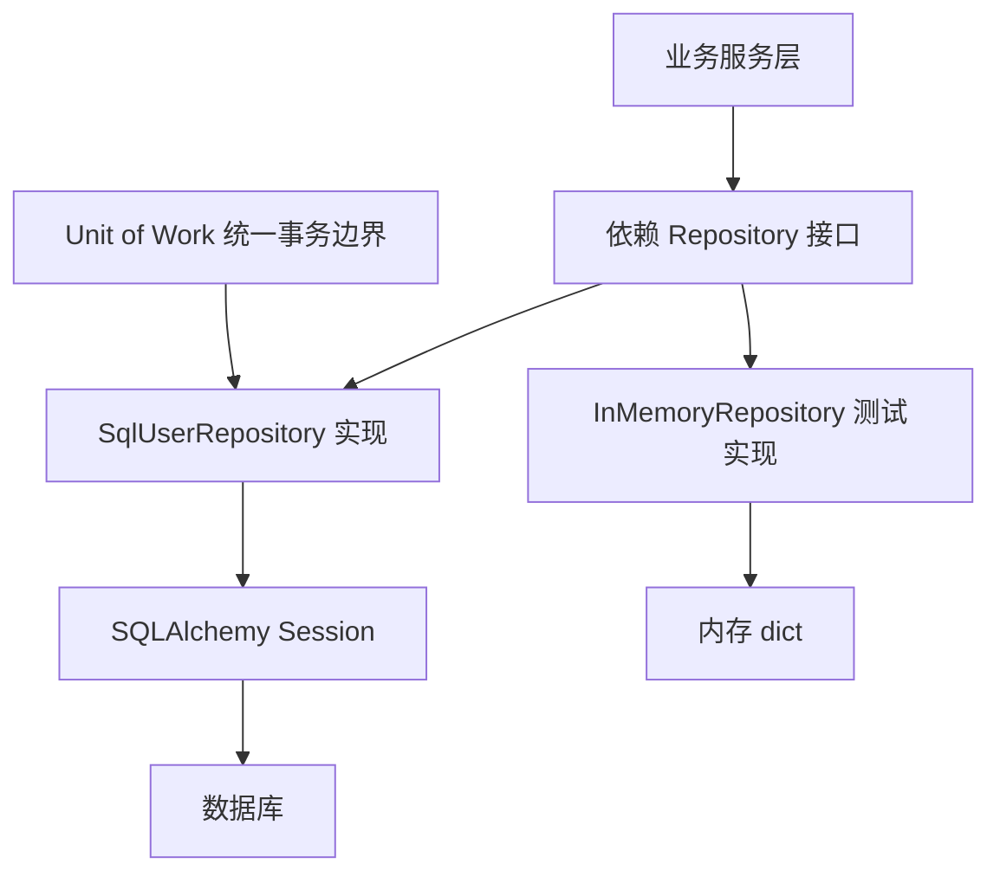

### Q920 · Repository 模式: 隔离 ORM 的数据访问层

> 难度:★★★★ | 标签:架构, Repository

**问**:什么是 Repository 模式?在 SQLAlchemy 项目里怎么落地,收益是什么?

**答**:Repository 把"持久化操作"封装成面向领域的接口(get/save/list),业务层只依赖接口不接触 Session 与 ORM 模型,依赖倒置让单测可以换内存实现、换存储引擎不动业务。落地要点:一个聚合根一个 Repository;接口定义在领域层(Protocol/ABC),实现放在基础设施层注入;Repository 方法语义是业务动作(find_active_users)而非 CRUD 直译,避免退化为"贫血 DAO";事务边界不放在 Repository 内部,由上层 Unit of Work 统一管(Q921),否则跨仓储操作无法同事务。

```python
# file: code/04_数据库与缓存/q920_repository.py
"""Repository 模式: 接口 Protocol + SQLAlchemy 实现 + 业务服务"""
from __future__ import annotations
from typing import Protocol

try:
    from sqlalchemy import create_engine, select
    from sqlalchemy.orm import Session, DeclarativeBase, Mapped, mapped_column
except ImportError:
    print("该题演示需要第三方库 sqlalchemy:pip install sqlalchemy>=2.0,原理见正文")
    raise SystemExit(0)

class Base(DeclarativeBase):
    pass

class User(Base):
    __tablename__ = "users"
    id: Mapped[int] = mapped_column(primary_key=True)
    name: Mapped[str]
    active: Mapped[bool] = mapped_column(default=True)

class UserRepository(Protocol):
    def get(self, id_: int) -> User | None: ...
    def add(self, user: User) -> None: ...
    def list_active(self) -> list[User]: ...

class SqlUserRepository:
    def __init__(self, session: Session):
        self.session = session
    def get(self, id_: int):
        return self.session.get(User, id_)
    def add(self, user):
        self.session.add(user)
    def list_active(self):
        return list(self.session.scalars(
            select(User).where(User.active == True)))  # noqa: E712

def register(repo: UserRepository, name: str) -> User:
    """业务层只依赖接口, 不知道 ORM 存在"""
    u = User(name=name)
    repo.add(u)
    return u

if __name__ == "__main__":
    engine = create_engine("sqlite://")
    Base.metadata.create_all(engine)
    with Session(engine) as s:
        repo = SqlUserRepository(s)
        register(repo, "alice")
        register(repo, "bob")
        s.commit()
        print("活跃用户:", [u.name for u in repo.list_active()])
```

**追问**:
- Repository 与 DAO 的区别?——DAO 面向表做 CRUD,Repository 面向聚合根表达领域语义,并为聚合提供一致的存取入口。
- 单测怎么替换实现?——测试里写个 InMemoryUserRepository 维护 dict,业务服务代码零改动,这正是依赖倒置的验证点。

---


