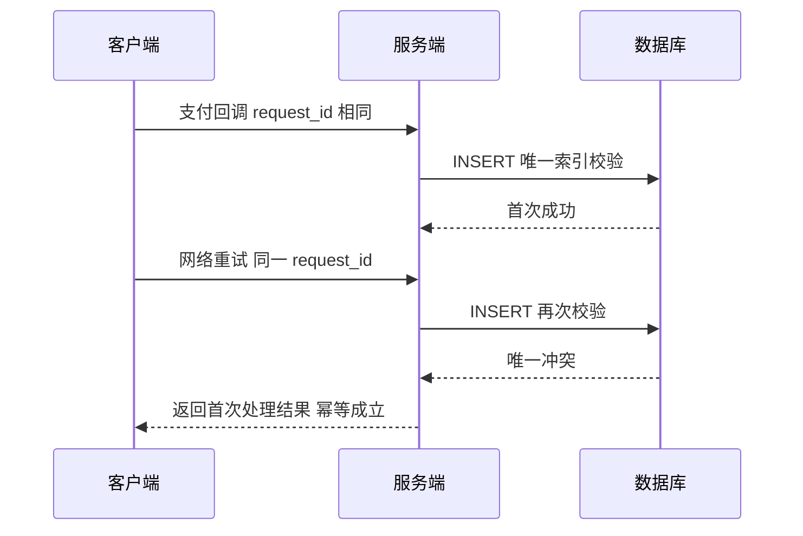

### Q925 · 幂等写入: 唯一约束 + 冲突处理

> 难度:★★★★ | 标签:幂等, 约束

**问**:支付回调可能重复通知,写入层怎么保证幂等?get-or-create 有竞态吗?

**答**:幂等写入的基石是数据库唯一约束:以业务键(外部流水号 request_id/支付单号)建唯一索引,重复写入触发冲突,再按业务"返回已有结果"(DO NOTHING)或"合并更新"(DO UPDATE)处理。应用层 get-or-create(先查后插)在并发下有竞态——两个请求都查不到然后都插,一个必然撞唯一约束,所以正确姿势是"直接插入 + 捕获 IntegrityError + 回读",或 upsert 一步到位。配合幂等表(记录 request_id 处理结果)可把"重复请求返回相同响应"也做掉,这是消息消费与回调场景的标准答案。

```python
# file: code/04_数据库与缓存/q925_idempotent_write.py
"""唯一约束实现幂等: 重复回调返回既有结果"""
import sqlite3

SCHEMA = """
CREATE TABLE payment (
    request_id TEXT PRIMARY KEY,     -- 外部流水号: 幂等键
    order_no  TEXT NOT NULL, amount INT NOT NULL, status TEXT NOT NULL
);
"""

def handle_callback(conn, request_id, order_no, amount):
    try:
        conn.execute(
            "INSERT INTO payment (request_id, order_no, amount, status) "
            "VALUES (?, ?, ?, 'paid')", (request_id, order_no, amount))
        conn.commit()
        return "首次处理"
    except sqlite3.IntegrityError:
        conn.rollback()
        return "重复请求, 返回既有结果"

if __name__ == "__main__":
    conn = sqlite3.connect(":memory:")
    conn.executescript(SCHEMA)
    for i in range(3):                  # 模拟回调重试 3 次
        print(f"第{i + 1}次回调:", handle_callback(conn, "req-1", "O100", 9900))
    print("落库:", conn.execute("SELECT request_id, status FROM payment").fetchall())
```

**追问**:
- upsert 与"唯一约束+捕获异常"怎么选?——高频批量场景 upsert 一条语句更高效;需要"重复时执行特殊业务逻辑(如告警)"时捕获异常更灵活。
- 没有天然业务键怎么办?——客户端生成 UUID 作 request_id 随请求携带,服务端建唯一索引,这与"防重 token"是同一机制。

---



---
