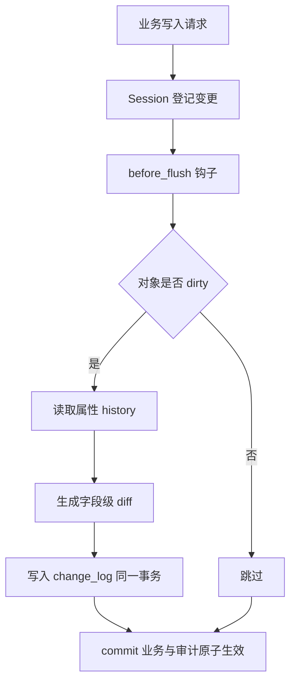

### Q930 · 审计字段与变更历史表

> 难度:★★★☆ | 标签:审计, 架构

**问**:created_at/updated_at/created_by 怎么统一维护?核心表要精确变更历史怎么办?

**答**:基础审计四件套 created_at/updated_at/created_by/updated_by 用 ORM 默认值与事件统一注入:on insert 设置 created/updated,on update 刷新 updated(SQLAlchemy 的 onupdate 或 before_flush),操作人从请求上下文注入而不是散在各调用点。要精确到"谁在什么时候把余额从 100 改成 80"则用变更历史表:在 before_flush 里对比 dirty 对象的属性历史(inspect(obj).attrs.x.history),把字段级 diff 写入 audit_log(表名、主键、字段、旧值、新值、操作人、时间),与业务同事务。历史表只插不改,定期归档;大流量表选抽样或只记关键字段,别让审计成为写放大源。

```python
# file: code/04_数据库与缓存/q930_audit_history.py
"""before_flush 对比属性历史, 写字段级变更日志"""

try:
    from sqlalchemy import create_engine, event, select
    from sqlalchemy.orm import Session, DeclarativeBase, Mapped, mapped_column
    from sqlalchemy import inspect as sa_inspect
except ImportError:
    print("该题演示需要第三方库 sqlalchemy:pip install sqlalchemy>=2.0,原理见正文")
    raise SystemExit(0)

class Base(DeclarativeBase):
    pass

class Account(Base):
    __tablename__ = "accounts"
    id: Mapped[int] = mapped_column(primary_key=True)
    name: Mapped[str]
    balance: Mapped[int]

class ChangeLog(Base):
    __tablename__ = "change_log"
    id: Mapped[int] = mapped_column(primary_key=True)
    entity: Mapped[str]
    field: Mapped[str]
    old: Mapped[str]
    new: Mapped[str]

if __name__ == "__main__":
    engine = create_engine("sqlite://")
    Base.metadata.create_all(engine)

    @event.listens_for(Session, "before_flush")
    def log_changes(session, ctx, instances):
        for obj in session.dirty:
            insp = sa_inspect(obj)
            for field in ("name", "balance"):
                hist = insp.attrs[field].history
                if hist.has_changes():
                    session.add(ChangeLog(
                        entity=type(obj).__name__, field=field,
                        old=str(hist.deleted[0]), new=str(hist.added[0])))

    with Session(engine) as s:
        s.add(Account(name="alice", balance=100))
        s.commit()
        acc = s.scalars(select(Account)).one()
        acc.balance = 80
        s.commit()
        print("变更日志:", s.execute(
            select(ChangeLog.field, ChangeLog.old, ChangeLog.new)).all())
```

**追问**:
- updated_at 用数据库 onupdate 还是应用层?——数据库层保证任何入口写入都刷新,应用层(OB onupdate 参数)在跨 ORM 写入(如原生 SQL)时失效,核心表建议双保险。
- 历史表查询慢怎么办?——按实体与主键建索引、按月归档,或改用事件流(Kafka/binlog)供下游异步构建审计。

---


