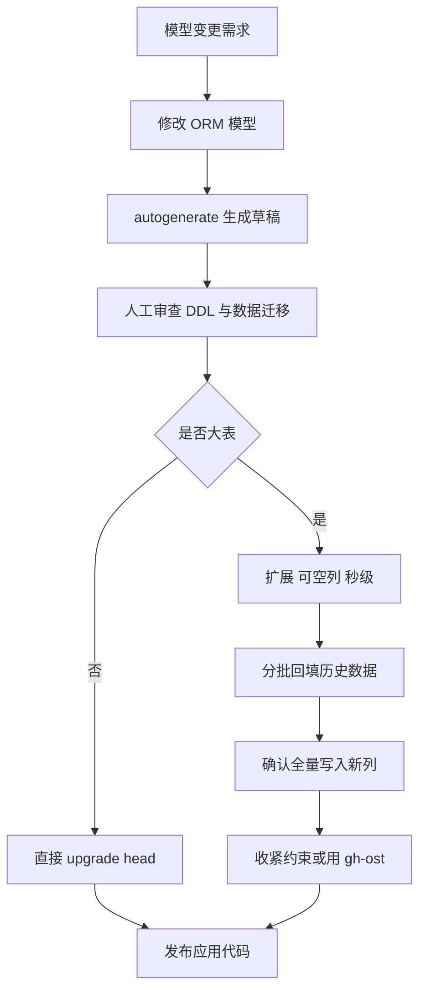

### Q935 · JSON 字段: 使用场景与索引方案

> 难度:★★★★ | 标签:JSON, 索引

**问**:什么时候用 JSON 列?怎么对 JSON 内部字段建索引查询?

**答**:JSON 列适合"弱结构、读整体、低频条件查询"的数据:扩展属性、第三方原始报文、配置快照;不适合作为核心查询维度——所有结构化、要索引、要约束的字段都该是普通列。索引方案:MySQL 8 用生成列/函数索引把 `JSON_EXTRACT(info, '$.city')` 物化后建索引,或 8.0.17+ 的多值索引服务 MEMBER OF 数组查询;PG 的 GIN 索引直接支持 jsonb 路径查询;SQLite 用表达式索引 + json_extract,配合生成列更稳。设计纪律:JSON 内的"重要字段"迟早会升格为普通列,提前规划迁移路径。

```python
# file: code/04_数据库与缓存/q935_json_field.py
"""sqlite JSON 列 + 生成列索引: 按内部字段高效查询"""
import json
import sqlite3

if __name__ == "__main__":
    conn = sqlite3.connect(":memory:")
    conn.execute("""CREATE TABLE profile (
        id INTEGER PRIMARY KEY,
        info TEXT,
        city TEXT GENERATED ALWAYS AS (json_extract(info, '$.city')) VIRTUAL)""")
    conn.executemany("INSERT INTO profile (info) VALUES (?)",
                     [(json.dumps({"name": n, "city": c}),) for n, c in
                      [("alice", "BJ"), ("bob", "SH"), ("carol", "BJ")]])
    conn.execute("CREATE INDEX idx_city ON profile (city)")

    plan = conn.execute(
        "EXPLAIN QUERY PLAN SELECT * FROM profile WHERE city = 'BJ'").fetchall()
    print("计划:", [r[3] for r in plan])
    print("命中:", conn.execute(
        "SELECT json_extract(info, '$.name') FROM profile WHERE city = ?",
        ("BJ",)).fetchall())
```

**追问**:
- JSON 列会影响备份与迁移吗?——大 JSON 拖宽行与备份,迁移时 DDL 对 JSON 变更支持有限,结构演进要靠应用层版本号兼容。
- jsonb 与 json 的区别?——PG 的 jsonb 存解析后的二进制,可索引可高效查询,写入稍贵;MySQL 的 JSON 类型内部二进制类似 jsonb。

---



---
