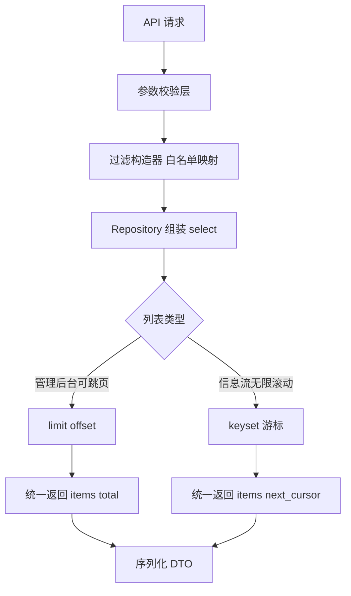

### Q940 · ORM 分页: offset 与 keyset 两套实现

> 难度:★★★☆ | 标签:SQLAlchemy, 分页

**问**:ORM 里怎么实现分页?什么场景必须换游标分页?

**答**:offset 分页:`select(User).order_by(User.id).limit(size).offset(page * size)`,实现简单支持跳页,但深偏移性能差且数据变动时页会漂移。keyset 分页:记录本页最后一行的排序键,`where((sort_col, id) < (last_val, last_id))` + limit,恒定性能、结果稳定,配合 base64 编码的 cursor token 暴露给前端;复合排序时用行值比较或展开为 OR 条件。ORM 层封装成 paginate(query, cursor) 返回 (items, next_cursor),排序键必须含唯一列做 tie-breaker。管理后台的跳页需求保留 offset,面向 API 的无限滚动用 keyset。

```python
# file: code/04_数据库与缓存/q940_orm_pagination.py
"""ORM 双分页: limit/offset 与 keyset 游标"""
import base64
import json

try:
    from sqlalchemy import create_engine, select
    from sqlalchemy.orm import Session, DeclarativeBase, Mapped, mapped_column
except ImportError:
    print("该题演示需要第三方库 sqlalchemy:pip install sqlalchemy>=2.0,原理见正文")
    raise SystemExit(0)

class Base(DeclarativeBase):
    pass

class Feed(Base):
    __tablename__ = "feed"
    id: Mapped[int] = mapped_column(primary_key=True)
    score: Mapped[float]

def offset_page(s, page, size=3):
    return s.scalars(select(Feed).order_by(Feed.score.desc(), Feed.id)
                     .limit(size).offset(page * size)).all()

def keyset_page(s, cursor=None, size=3):
    stmt = select(Feed).order_by(Feed.score.desc(), Feed.id).limit(size)
    if cursor:
        c = json.loads(base64.b64decode(cursor))
        stmt = stmt.where((Feed.score < c["s"]) |
                          ((Feed.score == c["s"]) & (Feed.id > c["i"])))
    rows = s.scalars(stmt).all()
    next_cursor = None
    if len(rows) == size:
        last = rows[-1]
        next_cursor = base64.b64encode(json.dumps(
            {"s": last.score, "i": last.id}).encode()).decode()
    return rows, next_cursor

if __name__ == "__main__":
    engine = create_engine("sqlite://")
    Base.metadata.create_all(engine)
    with Session(engine) as s:
        s.add_all([Feed(score=i % 10) for i in range(20)])
        s.commit()
        print("offset 第2页:", [f.id for f in offset_page(s, 1)])
        rows, cur = keyset_page(s)
        print("keyset 第1页:", [f.id for f in rows], "cursor:", bool(cur))
        rows2, _ = keyset_page(s, cur)
        print("keyset 第2页:", [f.id for f in rows2])
```

**追问**:
- cursor token 里放什么?——排序键值 + 唯一 id,base64 只是编码不是加密,敏感数据要签名或加密防篡改。
- offset 页中途插入数据会怎样?——页漂移(某条记录重复出现或漏掉),keyset 基于锚点不受影响,这正是它稳定的原因。

---


