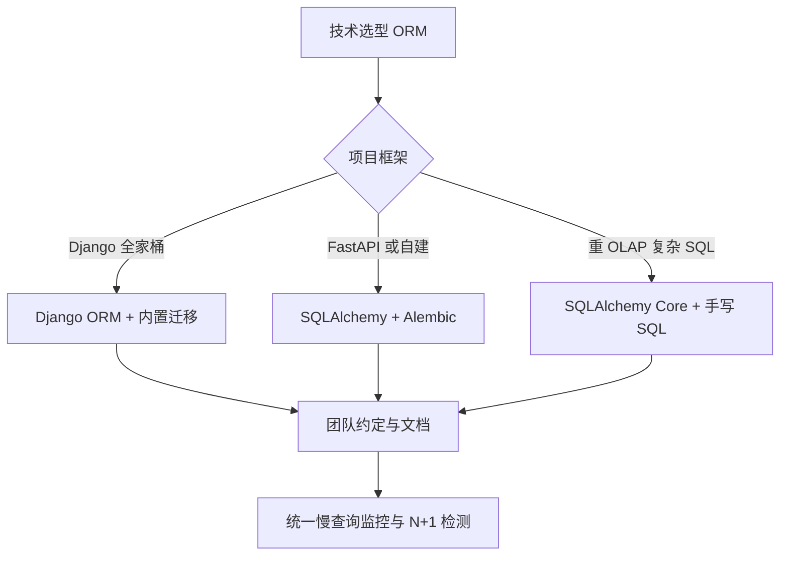

### Q945 · Django ORM 与 SQLAlchemy 怎么选

> 难度:★★★☆ | 标签:ORM, 选型

**问**:同样是 Python ORM,Django ORM 与 SQLAlchemy 的设计取舍有什么不同?

**答**:Django ORM 是"电池全含":Model 与迁移(内置 migrations)、Admin、表单联动,QuerySet 惰性求值链式过滤,学习成本低、约定强,适合 Django 全家桶项目;表达力边界在复杂查询(窗口函数已支持但组合复杂 SQL/多方言调优能力弱),脱离 Django 框架使用不便。SQLAlchemy 是独立组件:Core(表达式语言)+ ORM(声明式映射)两层可选,Session/UnitOfWork 语义清晰,复杂查询与性能调优空间大,FastAPI/非框架项目的默认选择,学习曲线更陡。选型即架构:已在 Django 生态内不必硬换;自建服务、需要精细控制 SQL 与事务边界的用 SQLAlchemy。两者都要求团队懂数据库,ORM 不替代 SQL 能力。

```python
# file: code/04_数据库与缓存/q945_orm_compare.py
"""同一查询在两套 ORM 心智模型下的写法对照"""
COMPARISON = """
同一需求: 取每个作者的书籍数, 只要有书的作者

Django ORM:
    Author.objects.annotate(n=Count("book")).filter(n__gt=0)
    # QuerySet 惰性链, 迁移/admin 与模型一体

SQLAlchemy 2.0:
    select(Author, func.count(Book.id)).join(Book) \\
        .group_by(Author).having(func.count(Book.id) > 0)
    # 显式 join/group/having, Session 管理事务与状态

取舍:
  Django: 约定优先 上手快 生态内全链路  复杂 SQL 受限
  SQLAlchemy: 显式优先 控制力强 独立于框架  学习曲线陡
"""
if __name__ == "__main__":
    print(COMPARISON)
```

**追问**:
- Django 能脱离框架用它的 ORM 吗?——可以但牵扯 settings 与 apps 配置,得不偿失,独立服务直接用 SQLAlchemy 更顺。
- 团队从 Django 迁到 FastAPI,数据层怎么迁?——模型层重写为 SQLAlchemy,迁移历史用 Alembic 重建,业务查询按 Repository 收口逐模块替换。

---


