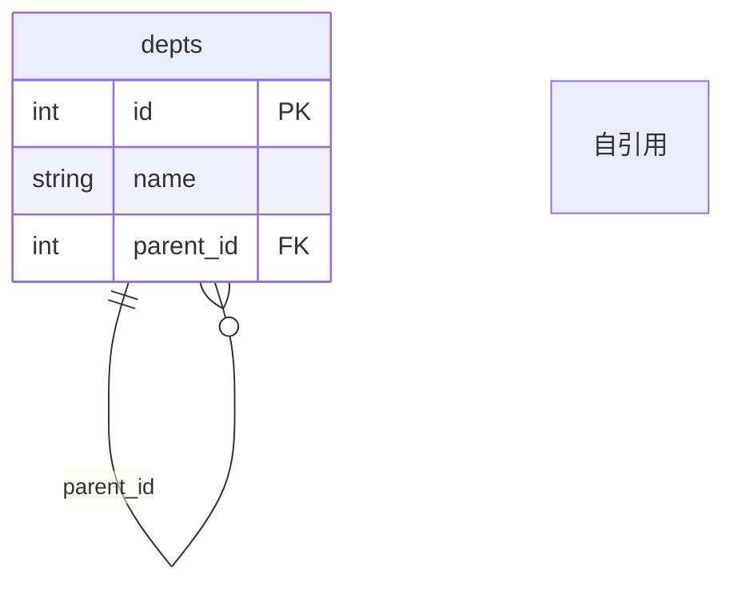

### Q950 · 自引用关系: 部门树与评论楼的 ORM 表达

> 难度:★★★★ | 标签:SQLAlchemy, 树形结构

**问**:ORM 里怎么表达"部门的上级与下级"?整棵树/子树查询怎么做才高效?

**答**:自引用 relationship:ForeignKey 指向本表,parent 与 children 互为 back_populates。加载策略:取"直接上下级"用 selectinload(Team.children) 一层;整棵树用递归 CTE(Core 的 cte 或原生 SQL)一条语句拿到路径与深度,Python 侧按 parent 组装,比逐层懒加载(N 层 = N 轮查询)高效得多;频繁读整树时缓存或改物化路径(path 列存 '1/4/9')与闭包表,查询 O(1) 定位子树。删除要定义级联语义(禁删有子节点或级联软删)。评论楼同理,排序键 path 或 (root_id, floor) 让"楼中楼"按序取出。

```python
# file: code/04_数据库与缓存/q950_self_referential.py
"""自引用 relationship + 递归 CTE 取整棵树"""
from typing import Optional

try:
    from sqlalchemy import (create_engine, ForeignKey, select, text)
    from sqlalchemy.orm import (Session, DeclarativeBase, Mapped,
                                mapped_column, relationship, selectinload)
except ImportError:
    print("该题演示需要第三方库 sqlalchemy:pip install sqlalchemy>=2.0,原理见正文")
    raise SystemExit(0)

class Base(DeclarativeBase):
    pass

class Dept(Base):
    __tablename__ = "depts"
    id: Mapped[int] = mapped_column(primary_key=True)
    name: Mapped[str]
    parent_id: Mapped[Optional[int]] = mapped_column(
        ForeignKey("depts.id"), nullable=True)
    children: Mapped[list["Dept"]] = relationship(back_populates="parent")
    parent: Mapped[Optional["Dept"]] = relationship(
        back_populates="children", remote_side=[id])

if __name__ == "__main__":
    engine = create_engine("sqlite://")
    Base.metadata.create_all(engine)
    with Session(engine) as s:
        ceo = Dept(name="ceo")
        cto = Dept(name="cto", parent=ceo)
        cto.children = [Dept(name="dev"), Dept(name="qa")]
        s.add(ceo); s.commit()

        # 一层: selectinload 直接子部门
        root = s.scalars(select(Dept).options(
            selectinload(Dept.children))).first()
        print("直接子部门:", [c.name for c in root.children])

        # 整树: 递归 CTE
        sql = text("""
            WITH RECURSIVE tree AS (
              SELECT id, name, 0 AS depth, name AS path FROM depts WHERE parent_id IS NULL
              UNION ALL
              SELECT d.id, d.name, t.depth + 1, t.path || '/' || d.name
              FROM depts d JOIN tree t ON d.parent_id = t.id
            )
            SELECT depth, path FROM tree ORDER BY path
        """)
        for depth, path in s.execute(sql):
            print("  " * depth + path)
```

**追问**:
- 为什么逐层懒加载不可取?——树深 N 层就是 N 轮查询,每层每个节点再乘关系数,很容易演变成"树形 N+1",必须一次递归或预物化。
- 物化路径怎么支持改名?——path 含父名时改名要重写整棵子树,改用纯 id 路径('1/4/9')则不需要;两者都要在写路径上补偿成本。

---


