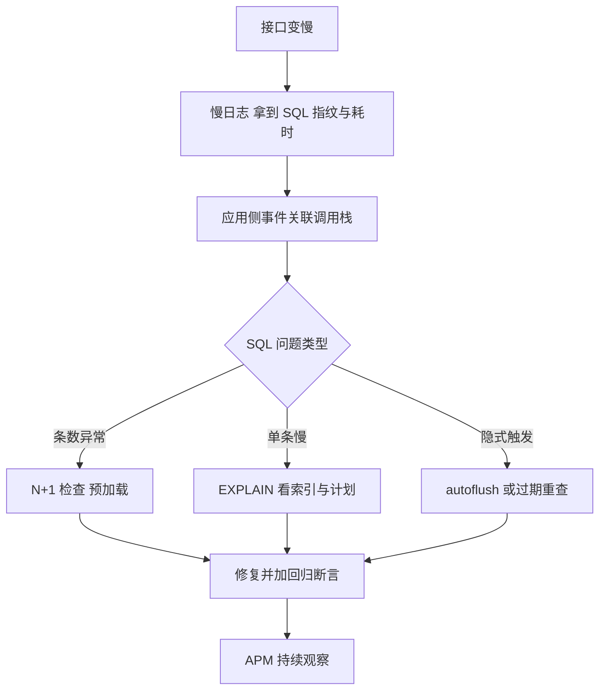

### Q955 · ORM 慢查询定位: 从日志到代码行

> 难度:★★★★ | 标签:SQLAlchemy, 排查

**问**:线上接口变慢,怎么定位是哪段 ORM 代码发出的慢 SQL?

**答**:三层定位:一、数据库侧慢日志拿到 SQL 指纹(MySQL slowlog + pt-query-digest);二、应用侧把 SQL 与代码关联——SQLAlchemy 的 before_cursor_execute 事件里可拿到 connection 与语句,配合 `info` 字段或上下文变量记录当前请求路径;更直接的是 echo=True(开发环境)或事件把语句与调用栈快照(traceback.extract_stack 过滤 sqlalchemy 帧)一起打出来,慢 SQL 即刻对应到函数;三、APM(如 OpenTelemetry)自动给每条 SQL 挂 trace,跨服务可见。修复常见三样:N+1 预加载、缺索引、session 里的隐式 autoflush 查询。关键习惯:开发期就开 SQL 计数,别等线上。

```python
# file: code/04_数据库与缓存/q955_slow_sql_trace.py
"""before_cursor_execute 记录调用栈: 慢 SQL 直接定位到函数"""
import time
import traceback

try:
    from sqlalchemy import create_engine, event, select
    from sqlalchemy.orm import Session, DeclarativeBase, Mapped, mapped_column
except ImportError:
    print("该题演示需要第三方库 sqlalchemy:pip install sqlalchemy>=2.0,原理见正文")
    raise SystemExit(0)

class Base(DeclarativeBase):
    pass

class User(Base):
    __tablename__ = "users"
    id: Mapped[int] = mapped_column(primary_key=True)
    name: Mapped[str]

SLOW_MS = 0.5
slow_log = []

def business_code(session):
    return session.scalars(select(User).where(User.name == "alice")).all()

if __name__ == "__main__":
    engine = create_engine("sqlite://")
    Base.metadata.create_all(engine)

    @event.listens_for(engine, "before_cursor_execute")
    def _t(conn, cursor, stmt, params, *a):
        conn.info["t0"] = time.perf_counter()

    @event.listens_for(engine, "after_cursor_execute")
    def _t2(conn, cursor, stmt, params, *a):
        cost = (time.perf_counter() - conn.info["t0"]) * 1000
        if cost >= SLOW_MS:
            frames = [f.name for f in traceback.extract_stack()
                      if "sqlalchemy" not in f.filename]
            slow_log.append((stmt[:40], round(cost, 2), frames[-2:]))

    with Session(engine) as s:
        s.add(User(name="alice")); s.commit()
        business_code(s)
        print("慢 SQL 日志:", slow_log or "本次无超过阈值的 SQL")
        print("生产环境把 frames 换成完整调用栈即可定位到代码行")
```

**追问**:
- echo=True 能上生产吗?——不能,全量语句日志的 IO 与字符串格式化开销巨大,生产用事件 + 阈值采样。
- 为什么调用栈要过滤 sqlalchemy 帧?——栈里大半是 ORM 内部调用,过滤后剩下的业务函数才是"谁发起了这条 SQL"。

---


