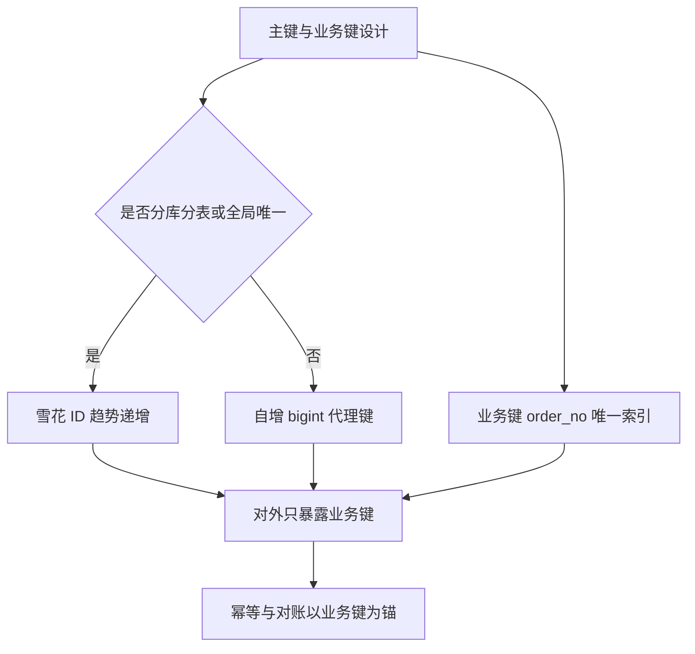

### Q960 · 唯一业务键: 自然键与代理键的分工

> 难度:★★★☆ | 标签:约束, 建模

**问**:表里既要有自增 id 又要有 order_no,两者关系怎么定?业务键怎么设计?

**答**:分工明确:自增 id(代理键)做物理主键,服务连接、索引与 ORM;业务键(order_no,自然键)承载对外语义与幂等,建唯一索引。业务键设计要点:含时间与随机成分防猜测(时间戳+机器+序列,即雪花思路),或含分片信息支持直路由(Q924);长度固定、字符集收敛(大写字母+数字),便于对账与人工沟通。两者冲突场景:导入/同步时以业务键做 upsert 锚点;主键迁移(分表)时 id 可变而业务键不变。禁令:业务键可变(改订单号)——一旦可变,所有以它为锚的幂等与缓存全部失效,必须设计成不可变。

```python
# file: code/04_数据库与缓存/q960_business_key.py
"""代理键 + 业务键: 生成 order_no 并以此锚定 upsert"""
import secrets
import sqlite3
import time

def gen_order_no() -> str:
    ts = f"{int(time.time() * 1000) % 10**10:010d}"
    return f"PO{ts}{secrets.randbelow(10**4):04d}"     # 时间 + 随机, 不可猜测

if __name__ == "__main__":
    conn = sqlite3.connect(":memory:")
    conn.execute("""CREATE TABLE orders (
        id INTEGER PRIMARY KEY AUTOINCREMENT,
        order_no TEXT NOT NULL UNIQUE, amount INT)""")

    no = gen_order_no()
    for i in range(2):                     # 重复提交同一 order_no
        try:
            conn.execute("INSERT INTO orders (order_no, amount) VALUES (?, ?)",
                         (no, 9900))
            conn.commit()
            print(f"第{i + 1}次提交 {no}: 成功")
        except sqlite3.IntegrityError:
            conn.rollback()
            print(f"第{i + 1}次提交 {no}: 唯一冲突, 幂等返回")
    print("落库:", conn.execute("SELECT id, order_no FROM orders").fetchall())
```

**追问**:
- 业务键要加业务前缀吗?——要,PO/PAY/REF 前缀区分域,跨系统对账一眼识别来源,也避免不同表键值撞车。
- 业务键唯一索引和幂等表什么关系?——同一机制的两面:业务键唯一索引天然提供幂等锚点,无业务键的接口才需要独立的 request_id 幂等表。

---


