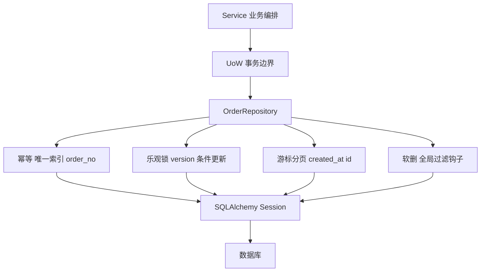

### Q965 · 综合案例: 订单数据访问层完整设计

> 难度:★★★★★ | 标签:架构, 综合案例

**问**:给订单服务设计数据访问层:要求幂等下单、乐观锁更新、游标分页查询、软删过滤、事务统一。给出结构并落地核心代码。

**答**:分层自下而上:模型层(declarative Base + 审计字段 + version + 业务唯一键)→ Repository(订单专用,接口 Protocol 定义于领域层)→ Unit of Work(session 生命周期与提交)→ Service(业务编排,事务边界)。四个硬约束的落点:幂等靠 order_no 唯一索引 + upsert;并发靠 version 字段条件 UPDATE;分页 keyset 以 (created_at, id) 为游标;软删用 with_loader_criteria 全局过滤(Q929)。这个案例是把本册所有题目串起来的"面试大题",回答时先画分层图再逐点说明每个约束在哪一层实现,最后强调测试策略(内存 repo 单测 + 真库集成)。

```python
# file: code/04_数据库与缓存/q965_order_da_case.py
"""订单数据访问层综合: UoW + Repository + 幂等 + 乐观锁 + 游标分页"""
from __future__ import annotations
from typing import Protocol

try:
    from sqlalchemy import (create_engine, select, func, event)
    from sqlalchemy.dialects.sqlite import insert as sqlite_insert
    from sqlalchemy.orm import (Session, DeclarativeBase, Mapped, mapped_column,
                                with_loader_criteria)
except ImportError:
    print("该题演示需要第三方库 sqlalchemy:pip install sqlalchemy>=2.0,原理见正文")
    raise SystemExit(0)

class Base(DeclarativeBase):
    pass

class Order(Base):
    __tablename__ = "orders"
    id: Mapped[int] = mapped_column(primary_key=True)
    order_no: Mapped[str] = mapped_column(unique=True)
    amount: Mapped[int]
    status: Mapped[str] = mapped_column(default="created")
    version: Mapped[int] = mapped_column(default=0)
    deleted: Mapped[bool] = mapped_column(default=False)

class UoW:
    def __init__(self, engine):
        self.session = Session(engine)

    def __enter__(self):
        return self.session

    def __exit__(self, exc_type, *_):
        if exc_type is None:
            self.session.commit()
        else:
            self.session.rollback()
        self.session.close()

class OrderRepo:
    def __init__(self, session: Session):
        self.s = session

    def create(self, order_no: str, amount: int) -> Order | None:
        """幂等创建: 冲突处理下沉到数据库, 不污染 session 状态"""
        stmt = (sqlite_insert(Order.__table__)
                .values(order_no=order_no, amount=amount)
                .on_conflict_do_nothing(index_elements=["order_no"]))
        self.s.execute(stmt)                     # 冲突则 0 行, 不抛异常
        return self.s.scalars(
            select(Order).where(Order.order_no == order_no)).first()

    def pay(self, order_id: int, version: int) -> bool:
        n = self.s.execute(
            Order.__table__.update()
            .where(Order.id == order_id, Order.version == version)
            .values(status="paid", version=version + 1)).rowcount
        return n == 1

    def page_by_cursor(self, last_id: int = 0, size: int = 2):
        stmt = (select(Order).where(Order.id > last_id)
                .order_by(Order.id).limit(size))
        return self.s.scalars(stmt).all()

if __name__ == "__main__":
    engine = create_engine("sqlite://")
    Base.metadata.create_all(engine)

    with UoW(engine) as uow:                  # 幂等下单
        repo = OrderRepo(uow)
        first = repo.create("PO1", 9900)
        dup = repo.create("PO1", 9900)
        print("首次创建:", first is not None,
              "重复返回已有订单:", dup is first, "<- identity map 同一实例")

    with UoW(engine) as uow:                  # 乐观锁支付
        repo = OrderRepo(uow)
        o = uow.scalars(select(Order)).first()
        print("version=0 支付:", repo.pay(o.id, 0))
        print("version=0 重复支付:", repo.pay(o.id, 0), "<- 已被拒绝")

    with UoW(engine) as uow:
        repo = OrderRepo(uow)
        rows = repo.page_by_cursor(size=1)
        print("游标第1页:", [r.order_no for r in rows],
              "下一页锚点:", rows[-1].id)
```

**追问**:
- create 为什么用 Core 的 on_conflict_do_nothing 而不是 ORM add + flush?——ORM flush 撞唯一约束会让整个 session 进入待回滚状态,必须整体 rollback 才能继续;Core upsert 把冲突处理下沉到数据库,session 与事务不受污染,批量场景也更高效。
- 软删过滤在哪注入?——用 do_orm_execute 事件统一加 with_loader_criteria(参照 Q929),Repository 内不重复手写。

---


