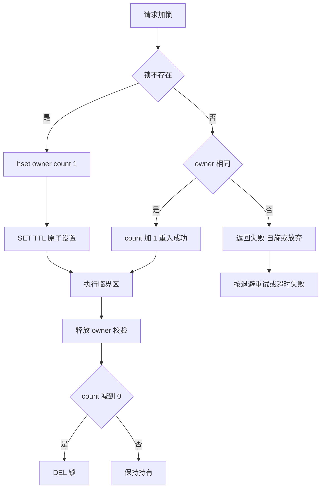

### Q970 · 可重入分布式锁: hash 结构与 owner 校验

> 难度:★★★★ | 标签:分布式锁, Redis

**问**:SETNX 锁怎么升级成可重入锁?同一线程重复加锁与误删他人的锁分别怎么处理?

**答**:可重入锁用 hash 而不是 string:key 存 `{owner: holder_id, count: 重入次数}`,加锁 Lua:若 key 不存在或 owner 匹配则 hincrby count、重设 TTL、返回成功;否则失败。解锁 Lua:owner 匹配才 hincrby -1,count 归零则 DEL,防止 A 超时后 B 获锁、A 回来删掉 B 的锁——这是 SETNX 锁最经典的误删事故,owner(token)校验是底线。重入场景:同一线程内嵌套调用同一临界区(方法 A 调方法 B 都加了同一把锁)。TTL 必须与加锁同命令设置(SET NX EX),避免"加了锁没来得及设过期就宕机"的死锁。续期问题交给看门狗(Q972)。

```python
# file: code/04_数据库与缓存/q970_reentrant_lock.py
"""可重入锁: hash 计数 + owner 校验 + TTL, 纯标准库模拟"""
import time
import uuid

class FakeRedis:
    def __init__(self):
        self.h = {}
        self.ttl = {}

    def lock_lua(self, key, owner, ttl):
        rec = self.h.get(key)
        if rec is None or rec["owner"] == owner:
            cnt = rec["count"] + 1 if rec else 1
            self.h[key] = {"owner": owner, "count": cnt}
            self.ttl[key] = time.monotonic() + ttl
            return 1
        return 0

    def unlock_lua(self, key, owner):
        rec = self.h.get(key)
        if rec and rec["owner"] == owner:
            rec["count"] -= 1
            if rec["count"] == 0:
                del self.h[key], self.ttl[key]
            return 1
        return 0

    def expired(self, key):
        return key in self.ttl and time.monotonic() > self.ttl[key]

class ReentrantLock:
    def __init__(self, r, key, ttl=2.0):
        self.r, self.key, self.ttl = r, key, ttl
        self.owner = uuid.uuid4().hex

    def acquire(self):
        return self.r.lock_lua(self.key, self.owner, self.ttl) == 1

    def release(self):
        return self.r.unlock_lua(self.key, self.owner) == 1

if __name__ == "__main__":
    r = FakeRedis()
    lock = ReentrantLock(r, "order:1")
    print("第一次加锁:", lock.acquire())
    print("同 owner 重入:", lock.acquire(), "<- count=2")
    other = ReentrantLock(r, "order:1")
    print("他人加锁被拒:", other.acquire() == 0)
    print("释放一层:", lock.release(), "仍持有:", lock.r.h.get("order:1"))
    print("再释放:", lock.release(), "锁已删除:", "order:1" not in r.h)
```

**追问**:
- owner 用什么生成?——每客户端实例一次的 UUID,而不是线程 id(跨进程无意义);校验是"是否同一持有者实例"。
- 释放时 owner 校验失败说明什么?——大概率锁已过期被他人持有,当前调用者应视为"加锁失败路径"处理业务,而不是强行删锁。

---



---
