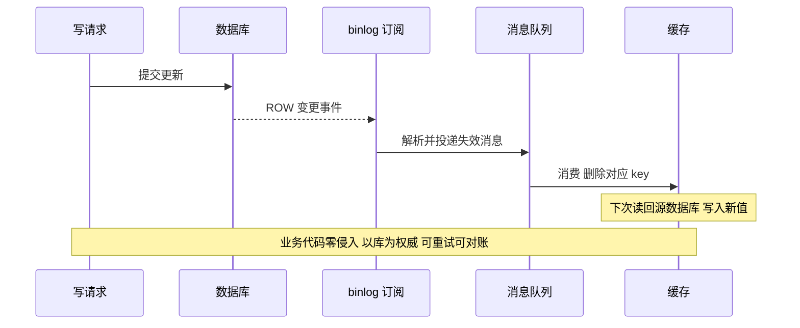

### Q975 · 多级缓存: 本地 L1 + Redis L2 的一致性

> 难度:★★★★ | 标签:多级缓存, 架构

**问**:为什么用本地缓存+Redis 两级?多实例下 L1 怎么保持一致?

**答**:本地缓存(Caffeine/dict)无网络开销、扛热点,Redis 做共享二层与容量池;读路径 L1 miss -> L2 -> DB,写路径失效两级。难点是多实例 L1:一个实例改库后,其他实例的 L1 还是旧值。方案:一、短 TTL 让 L1 快速自愈(秒级,容忍窗口);二、失效广播——写后向所有实例发 pub/sub 或 MQ 消息,各实例删除自己的 L1 键;三、版本号——key 带 epoch,写时递增,读校验版本,旧版本自动失效。组合拳:短 TTL 兜底 + 主动广播加速。注意 L1 不放大对象(容量上限),防止 GC 压力;热点场景 L1 是热 key 治理(Q176)的正解。

```python
# file: code/04_数据库与缓存/q975_multilevel_cache.py
"""两级缓存 + 失效广播: 本实例写后通知其他实例删 L1"""
import queue
import threading

class Node:
    def __init__(self, name, bus):
        self.name, self.l1, self.bus = name, {}, bus
        bus.register(self)

    def get(self, key, l2, db):
        if key in self.l1:
            return self.l1[key], "L1"
        v = l2.get(key) or db.get(key)
        self.l1[key] = v
        return v, "L2/DB"

    def invalidate(self, key):
        self.l1.pop(key, None)

class Bus:
    def __init__(self):
        self.nodes, self.box = [], queue.Queue()

    def register(self, node):
        self.nodes.append(node)

    def broadcast_invalidate(self, src, key):
        for n in self.nodes:                  # pub/sub: 逐节点投递失效
            if n is not src:
                n.invalidate(key)

if __name__ == "__main__":
    db, l2 = {"stock": 10}, {"stock": 10}
    bus = Bus()
    a, b = Node("nodeA", bus), Node("nodeB", bus)

    print("B 读:", b.get("stock", l2, db))
    # nodeA 更新库并失效两级
    db["stock"], l2["stock"] = 99, 99
    bus.broadcast_invalidate(a, "stock")     # 广播已同步清空 B 的 L1
    print("广播后 B 再读:", b.get("stock", l2, db), "<- 已看到新值")
```

**追问**:
- 广播消息丢了怎么办?——L1 的短 TTL 兜底自愈;对强一点的要求用版本号,读时带版本校验,旧版本当 miss。
- L1 缓存什么数据合适?——读极多、变更少、体积小的(配置、类目、白名单);用户维度大数据放 L1 会撑爆进程内存。

---


