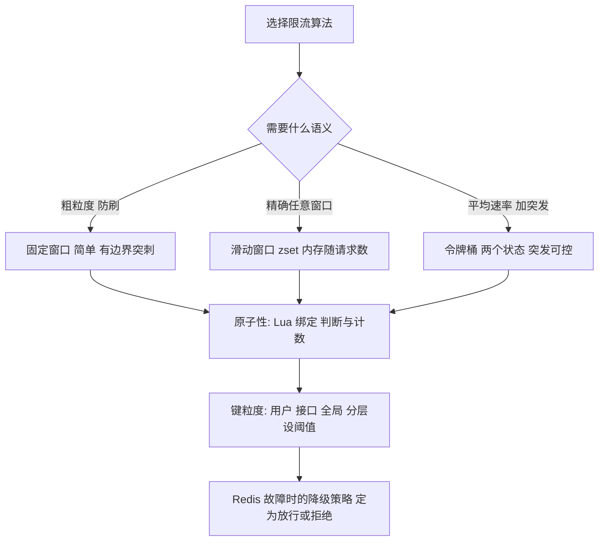

### Q980 · 令牌桶限流: 懒惰补充与突发容忍

> 难度:★★★★ | 标签:限流, Lua

**问**:令牌桶怎么用两个数就实现?它和滑动窗口比强在哪?

**答**:状态只有 (桶内令牌数, 上次补充时间),每次请求懒惰计算:应补 = (now - last) × 速率,封顶容量;有令牌则扣 1 放行。Lua 原子完成"补足+扣减"。两个可调维度:速率(平均 QPS)与桶容量(突发容忍度),这是它优于滑动窗口的核心——滑动窗口语义是"硬窗口",令牌桶允许短暂超速消化突发(比如允许瞬间 20 QPS、长期 5 QPS)。实现细节:浮点注意 Lua number 精度(用毫秒整数计算),长时间未用不能溢出(封顶)。Nginx limit_req、Guava RateLimiter 都是令牌桶家族。

```python
# file: code/04_数据库与缓存/q980_token_bucket.py
"""令牌桶: 懒惰补充 + 突发容忍"""
import time

class TokenBucket:
    def __init__(self, rate, capacity):
        self.rate, self.capacity = rate, capacity      # 每秒令牌数, 桶容量
        self.tokens, self.last = capacity, time.monotonic()

    def allow(self, cost=1.0):
        now = time.monotonic()
        self.tokens = min(self.capacity,             # 补充并封顶
                          self.tokens + (now - self.last) * self.rate)
        self.last = now
        if self.tokens >= cost:
            self.tokens -= cost
            return True
        return False

if __name__ == "__main__":
    tb = TokenBucket(rate=2, capacity=5)               # 均速2/s 突发可到5
    print("瞬时突发 5 次:", [tb.allow() for _ in range(5)], "<- 容量内全过")
    print("第 6 次:", tb.allow())
    time.sleep(0.6)                                    # 攒回约 1.2 个令牌
    print("0.6s 后:", tb.allow(), "<- 速率控制恢复节奏")
    print(f"剩余令牌 {tb.tokens:.2f}")
```

**追问**:
- 桶容量怎么定?——容量=允许的最大突发,参考上游(网关/客户端)的并发模型与下游容量;容量过大等于变相放开限流。
- 令牌桶在 Redis 上的键结构?——HASH 存 tokens/last_ts 两个数 + TTL,或直接两个 string;比 zset 方案内存 O(1),高 QPS 首选。

---



---
