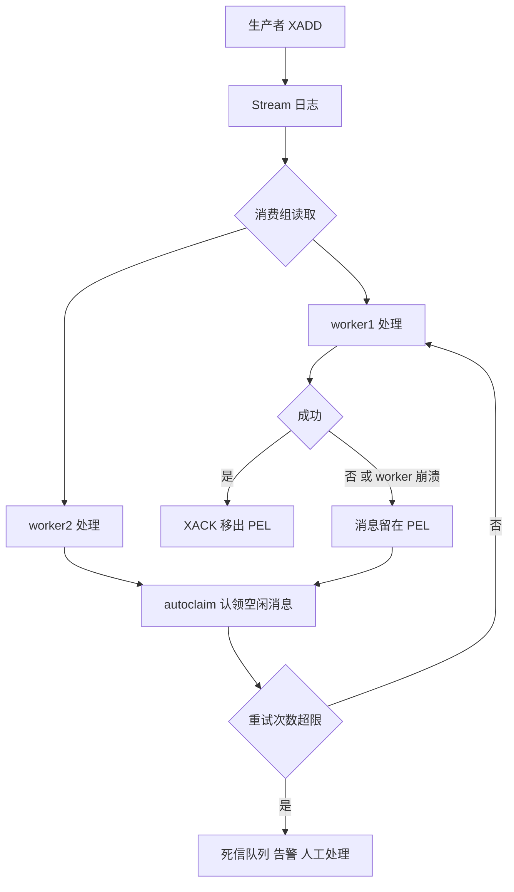

### Q985 · Stream pending 与死信: 可靠投递的最后一公里

> 难度:★★★★ | 标签:Stream, 可靠性

**问**:worker 崩了,它没 ack 的消息怎么办?什么情况进死信?

**答**:未确认消息在组的 PEL 中,XAUTOCLAIM(6.2+,老版本 XPENDING+XCLAIM)按空闲时间把"消费者失联"的消息转移给健康 worker 重投——这是崩溃恢复的标准动作。重试要有上限:每条消息带 delivery_count,超过阈值(如 5 次)转入死信处理(独立 stream/表 + 告警 + 人工),避免毒消息(Poison Message)无限循环打爆系统。监控三件套:PEL 深度、最老未确认消息年龄、死信数量。配套纪律:处理逻辑必须幂等(重投必然发生),业务以消息 ID 或业务键去重。

```python
# file: code/04_数据库与缓存/q985_pending_deadline.py
"""PEL 重投与死信转移: delivery_count 超限进 DLQ"""
import time

class Group:
    def __init__(self):
        self.pel = {}                       # mid -> {consumer, count, ts}

    def delivered(self, mid, consumer):
        rec = self.pel.setdefault(mid, {"consumer": consumer, "count": 0,
                                        "ts": time.monotonic()})
        rec["count"] += 1

    def ack(self, mid):
        self.pel.pop(mid, None)

    def autoclaim(self, dead_after_count=3, idle=0.1):
        now = time.monotonic()
        reclaim, dead = [], []
        for mid, rec in list(self.pel.items()):
            if now - rec["ts"] > idle:
                if rec["count"] >= dead_after_count:
                    dead.append(mid)
                    del self.pel[mid]          # 转入死信队列后移出 PEL
                else:
                    reclaim.append(mid)
        return reclaim, dead

if __name__ == "__main__":
    g = Group()
    for mid in ("1-0", "2-0", "3-0"):
        g.delivered(mid, "w1")              # w1 崩溃未 ack
    time.sleep(0.2)
    reclaim, dead = g.autoclaim()
    print("第一轮可重投:", reclaim, "死信:", dead)
    for mid in reclaim:
        g.delivered(mid, "w2")              # 转给健康 worker, 重试计数+1
    g.ack("1-0")                            # w2 处理成功
    reclaim, dead = g.autoclaim()
    for mid in reclaim:
        g.delivered(mid, "w3")              # 又重试一轮
    _, dead = g.autoclaim()                 # 计数到 3 -> 死信
    print("毒消息进死信:", dead, "<- 记录并告警, 人工介入")
    print("剩余 PEL:", g.pel)
```

**追问**:
- 重投导致重复消费怎么办?——消费端按业务键幂等(唯一约束/Redis setnx 标记),消息 ID 只能去重单 stream,跨重投要业务层兜底。
- idle 判定多久合适?——略大于处理 P99 时长(如 P99=2s 则 idle=5s),太短会频繁抢占正常处理中的消息。

---


