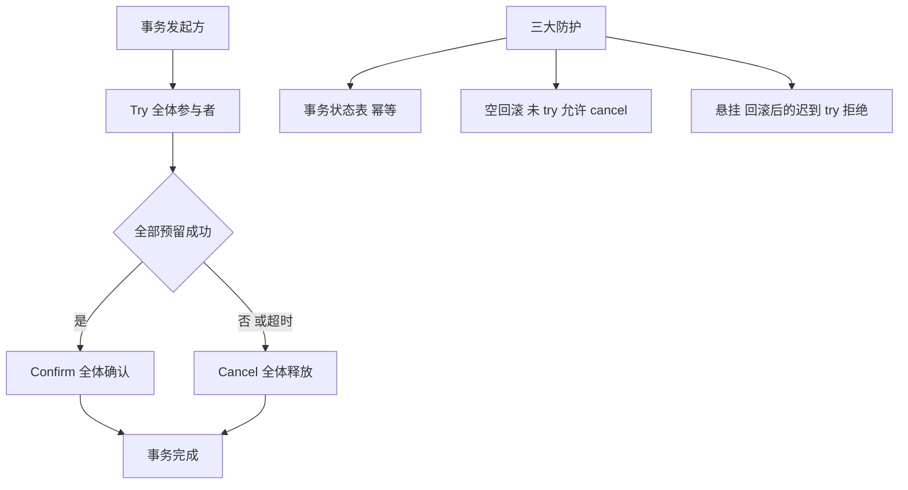

### Q990 · TCC: Try-Confirm-Cancel 的实现要点

> 难度:★★★★★ | 标签:分布式事务, TCC

**问**:TCC 三个阶段分别做什么?空回滚、悬挂、幂等三大问题怎么解?

**答**:Try 预留资源(冻结金额而非扣款),Confirm 确认(用预留资源完成),Cancel 释放预留。框架按事务 ID 驱动:任一参与者 Try 失败则全局 Cancel。三大经典问题:一、空回滚——Try 没到达(网络丢)而 Cancel 先到,Cancel 要能识别"从未 Try 过"并正常返回(记录事务状态表);二、悬挂——Cancel 执行后,Try 才迟到到达并预留了资源再无人释放,解法是 Try 前检查"该事务是否已回滚";三、幂等——Confirm/Cancel 都可能重试,必须可重复执行结果不变。实现上通常给每个事务参与者建状态记录(try/confirm/cancel 标记),配合本地事务保证状态与资源变更原子。TCC 强一致、性能好但侵入业务,适合资金类核心链路。

```python
# file: code/04_数据库与缓存/q990_tcc.py
"""TCC 最小模型: 冻结-确认-取消 + 空回滚与幂等防护"""
import sqlite3

def setup():
    conn = sqlite3.connect(":memory:")
    conn.executescript("""
        CREATE TABLE acct (id INTEGER PRIMARY KEY, bal INT, frozen INT DEFAULT 0);
        CREATE TABLE tx_log (txid TEXT, action TEXT, PRIMARY KEY (txid, action));
        INSERT INTO acct VALUES (1, 100, 0), (2, 0, 0);
    """)
    return conn

def once(conn, txid, action):
    try:
        conn.execute("INSERT INTO tx_log VALUES (?, ?)", (txid, action))
        return True
    except sqlite3.IntegrityError:
        return False                                # 幂等: 已执行过

def try_(conn, txid, amount):
    if not once(conn, txid, "try"):
        return "幂等跳过"
    conn.execute("UPDATE acct SET bal = bal - ?, frozen = frozen + ? WHERE id = 1",
                 (amount, amount))
    return "try 冻结完成"

def cancel(conn, txid, amount):
    done = once(conn, txid, "cancel")
    tried = conn.execute("SELECT 1 FROM tx_log WHERE txid=? AND action='try'",
                         (txid,)).fetchone()
    if not tried:
        conn.execute("INSERT INTO tx_log VALUES (?, 'try_null')", (txid,))
        return "空回滚: 未 try 过, 直接记取消成功"
    if not done:
        conn.execute("UPDATE acct SET bal = bal + ?, frozen = frozen - ? WHERE id = 1",
                     (amount, amount))
        return "cancel 释放冻结"
    return "cancel 幂等跳过"

def confirm(conn, txid, amount):
    if not once(conn, txid, "confirm"):
        return "confirm 幂等跳过"
    conn.execute("UPDATE acct SET frozen = frozen - ? WHERE id = 1", (amount,))
    conn.execute("UPDATE acct SET bal = bal + ? WHERE id = 2", (amount,))
    return "confirm 转账完成"

if __name__ == "__main__":
    conn = setup()
    print(try_(conn, "tx1", 30))
    print(confirm(conn, "tx1", 30))
    print(cancel(conn, "tx2", 50), "<- 空回滚演示")
    print("余额:", conn.execute("SELECT id, bal, frozen FROM acct").fetchall())
```

**追问**:
- TCC 的 Try 为什么要"冻结"而不是直接扣?——Try 阶段必须可逆,直接扣款后失败只能补偿(变成 SAGA);冻结让两阶段都有明确的资源边界。
- Cancel 比 Confirm 先执行会发生什么?——语义上框架保证先 Try 后分支,但网络重试可乱序,状态表按事务 ID 判定当前阶段,迟到消息按幂等丢弃。

---



---
