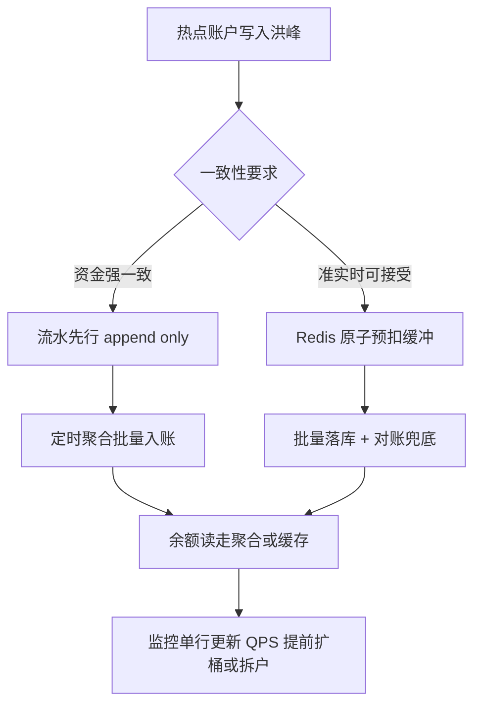

### Q995 · 热点账户: 高频加减余额的治理

> 难度:★★★★★ | 标签:热点, 架构

**问**:大商户账户每秒几千笔加减,行锁冲突严重,怎么治理?

**答**:热点账户的本质是"单行写竞争",治理分层:一、合并入账——明细先记账(append-only 流水,无竞争),余额异步聚合定时批量更新(秒级/分钟级),账户余额变成"准实时";二、分桶——余额拆 N 个子行随机落桶,加钱打任意桶、扣钱需跨桶调度,实现复杂;三、缓冲记账——Redis 预扣(Redis 原子 DECR),DB 批量落库,Redis 作为短时缓冲(注意对账与掉电窗口);四、业务拆分——把大商户拆成多个子账户(平台侧散列)。配合手段:读余额走流水聚合或缓存,别读热点行;监控单行更新 QPS 提前发现热点。选择:资金强一致用合并入账+分桶,准实时可接受用 Redis 缓冲。

```python
# file: code/04_数据库与缓存/q995_hot_account.py
"""热点账户: 流水先行 + 定时聚合入账"""
import itertools
import threading
import time

class HotAccount:
    def __init__(self, balance=1000):
        self.balance = balance
        self.pending = []                       # 待聚合流水
        self.lock = threading.Lock()

    def record(self, delta, memo):
        """记账只写流水: 单线程 append, 无行锁竞争"""
        with self.lock:
            self.pending.append((delta, memo))

    def settle(self):
        """定时聚合: 一次 UPDATE 应用全部流水"""
        with self.lock:
            total = sum(d for d, _ in self.pending)
            n, self.pending = len(self.pending), []
        self.balance += total
        return n, total

if __name__ == "__main__":
    acct = HotAccount()
    for i in range(100):                        # 模拟每秒几千笔中的一段
        acct.record(+1 if i % 3 else -2, f"tx{i}")
    n, total = acct.settle()
    print(f"聚合 {n} 笔, 净变动 {total}, 余额 {acct.balance}")
    print("要点: 明细与余额分离, 余额更新频率与热点解耦")
```

**追问**:
- 扣款在"准实时余额"下怎么防透支?——预留额度:大额扣减实时冻结,小额走缓冲;或按"日累计限额"控制缓冲池总量,保证最坏情况不穿底。
- 分桶方案里扣钱遇到单桶不足怎么办?——按桶余额降序尝试,不足则合并桶(锁两桶原子转移),极端情况退化到全局锁,所以桶数与阈值要按流量设计。

---


