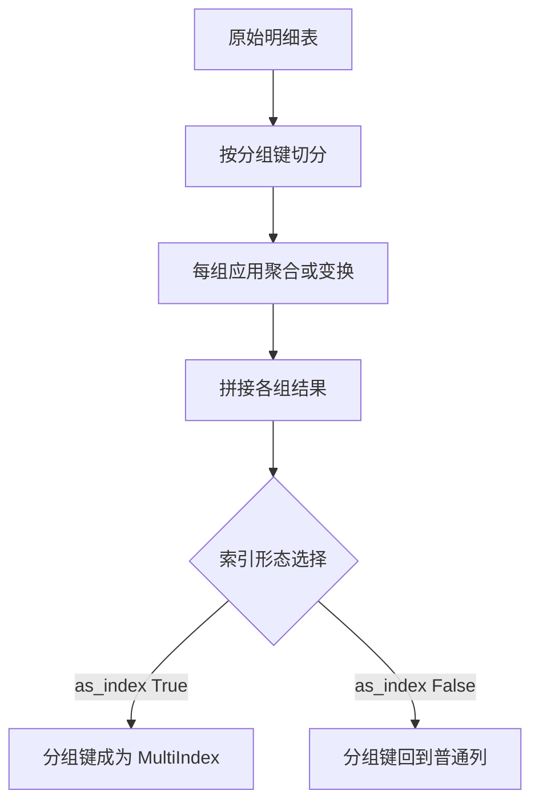

### Q1025 · 组级筛选 filter 与组内序号 cumcount

> 难度:★★★☆ | 标签:pandas, groupby

**问**:想保留"总销量达到阈值的整个分组",以及给用户的行为序列编号,分别怎么做?

**答**:组级筛选用 `groupby(键).filter(谓词)`,谓词函数接收每个分组子表并返回布尔值,返回 True 的整组保留,这是"按组指标过滤"的标准姿势,比先聚合再 merge 回去更直接。组内序号用 `cumcount()`,从 0 开始给组内行编号,常见用途:构造会话内第 N 次点击、配合 `cumcount() == 0` 取每组第一条等价于按组去重。两者都要求先想清楚排序键,序号的业务含义完全由排序决定。

```python
# file: code/05_数据分析与工程化/q1025_group_filter_cumcount.py
try:
    import pandas as pd
except ImportError:
    pd = None

if pd is None:
    from collections import defaultdict
    rows = [("bj", 10), ("bj", 25), ("sh", 5), ("sh", 6)]
    g = defaultdict(list)
    for city, amount in rows:
        g[city].append(amount)
    print("组级筛选:仅保留合计>=30 的组 ->", {k: v for k, v in g.items() if sum(v) >= 30})
else:
    df = pd.DataFrame({
        "user": ["u1", "u1", "u1", "u2"],
        "event": ["view", "cart", "pay", "view"],
        "amount": [10, 25, 5, 6],
    })
    # 组级筛选:只保留组内 amount 合计 >= 30 的组
    big = df.groupby("user").filter(lambda g: g["amount"].sum() >= 30)
    print(big, end="\n\n")
    # 组内序号:用户行为序列编号,并取每个用户第一条事件
    df = df.sort_values(["user", "event"])
    df["seq"] = df.groupby("user").cumcount() + 1
    first_event = df[df.groupby("user").cumcount() == 0]
    print(df, end="\n\n")
    print(first_event)
```

**追问**:
- 追问 1:filter 的谓词里能做复杂判断吗?—— 能,函数拿到完整子表,可以算多列组合指标,但要保持返回单个布尔值。
- 追问 2:cumcount 与 `ngroup()` 的区别?—— cumcount 是组内行号,ngroup 是组本身的序号,两者配合能唯一标识"第几组的第几行"。


