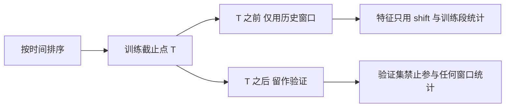

### Q1031 · 窗口特征的数据泄露

> 难度:★★★★ | 标签:特征工程, 数据泄露

**问**:用 rolling/shift 做特征喂给模型,什么是数据泄露?怎么从代码层面防住?

**答**:泄露指训练时用到了预测时点不可得的信息,常见三种:窗口包含未来样本(rolling 默认含当前行,标签也算进去了)、用全量数据算归一化统计量(均值方差来自验证期)、目标编码没有按时间切分。防护三板斧:特征只用 `shift(1)` 之后的历史;所有统计量只在训练段 fit、再应用到验证段;时间切分点之前的数据参与统计,之后的只做验证。评审时看到"没有时间概念的 mean/std/merge 统计"就应标记为疑似泄露。

```python
# file: code/05_数据分析与工程化/q1031_window_leakage.py
try:
    import pandas as pd
except ImportError:
    pd = None

if pd is None:
    print("标准库演示:滞后特征只用过去,标准化只用训练段统计")
    ys = [10, 11, 12, 13, 14, 100]
    train = ys[:4]
    mu = sum(train) / len(train)
    for i, y in enumerate(ys):
        lag1 = ys[i - 1] if i > 0 else None
        z = (y - mu) / (sum((t - mu) ** 2 for t in train) / len(train)) ** 0.5
        print(f"t{i} y={y} lag1={lag1} z_train_std={z:.2f}")
else:
    df = pd.DataFrame({"t": range(6), "y": [10, 11, 12, 13, 14, 100]})
    # 正确:滞后特征,只用过去
    df["lag1"] = df["y"].shift(1)
    train = df.iloc[:4]
    # 错误:全量标准化把验证期 100 算进均值方差
    df["z_bad"] = (df["y"] - df["y"].mean()) / df["y"].std()
    # 正确:统计量只用训练段
    df["z_good"] = (df["y"] - train["y"].mean()) / train["y"].std()
    print(df.round(2))
    assert df["z_bad"].round(6).tolist() != df["z_good"].round(6).tolist(), "两种口径应有差异"
    print("两种口径数值不同,说明全量统计确实泄露了验证期信息")
```

**追问**:
- 追问 1:rolling 算特征时当前行算不算未来?—— 若特征与标签同行产生,滚动窗口默认含当前行就是泄露,先 shift(1) 再 rolling。
- 追问 2:怎么在 CI 里自动防泄露?—— 写单元测试断言"特征在 t 时刻的值只依赖 t 之前数据",打乱未来数据后特征不变。


