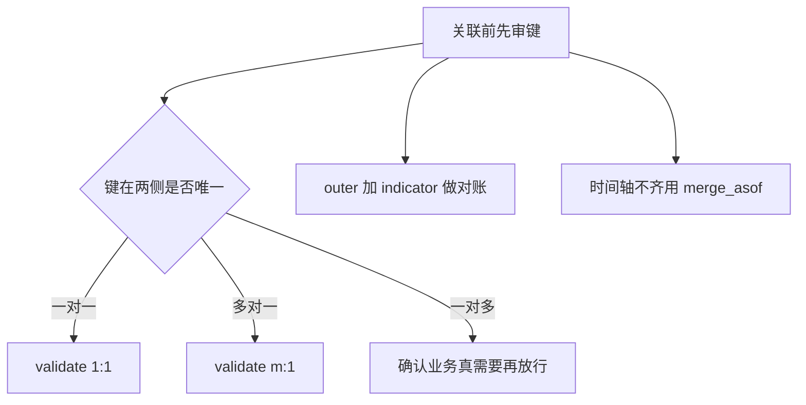

### Q1035 · merge_asof 时间就近匹配

> 难度:★★★★ | 标签:pandas, merge, 时间序列

**问**:成交表想关联"成交时刻最近的一条报价",普通 merge 对不上时间怎么办?

**答**:用 `merge_asof`:它按时间列做"就近匹配",左表每行拿右表中不晚于(left backward)该时刻的最近一行,而不是要求时间精确相等,天然适合行情对成交、日志对配置版本这类时间轴不齐的数据。硬性要求:两侧都必须按 `on` 列排序,`by` 指定分组键(如每个标的内部独立匹配),`tolerance` 限制最大可接受时差、超时返回 NaN,`direction` 可选 backward/forward/nearest。用错最多的就是忘记排序,直接抛异常反而是好事。

```python
# file: code/05_数据分析与工程化/q1035_merge_asof.py
try:
    import pandas as pd
except ImportError:
    pd = None

if pd is None:
    import bisect
    quotes = [(10, 9.9), (20, 10.1), (40, 10.4)]
    times = [t for t, _ in quotes]
    for trade_t in (12, 25, 45):
        i = bisect.bisect_right(times, trade_t) - 1
        if i >= 0:
            print(f"成交 {trade_t}s 匹配报价 {quotes[i]}")
else:
    quotes = pd.DataFrame({
        "ts": pd.to_datetime(["10:00:00", "10:00:20", "10:00:40"]),
        "price": [9.9, 10.1, 10.4],
    }).sort_values("ts")
    trades = pd.DataFrame({
        "ts": pd.to_datetime(["10:00:12", "10:00:25", "10:00:45"]),
        "qty": [100, 200, 50],
    }).sort_values("ts")
    m = pd.merge_asof(trades, quotes, on="ts", direction="backward", tolerance=pd.Timedelta("30s"))
    print(m)
```

**追问**:
- 追问 1:分组就近匹配怎么做?—— `by="symbol"`,每个标的只在自己内部找最近报价。
- 追问 2:两边时间都要求排序,谁负责保证?—— merge 前显式 sort_values,并在代码评审把"asof 前必排序"作为固定检查项。


