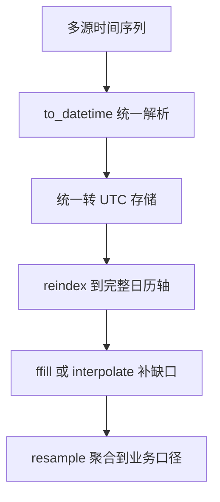

### Q1047 · reindex 时间对齐与 ffill

> 难度:★★★☆ | 标签:pandas, 时间序列

**问**:两个数据源的日指标想相除算比率,日期对不齐怎么处理?

**答**:先把两条序列 reindex 到同一根完整日历轴,再做对齐运算,这是多源指标联动的标准前置步骤。reindex 产生的缺口用 `method="ffill"` 前向填充(要求原索引单调),或 reindex 后再 `interpolate`;业务上要明确"缺日是补前值还是记缺失",金融类指标通常宁可留 NaN 也不要假数据。对比运算前还要确认两侧口径(自然日 vs 交易日)一致,否则对齐本身就在放大口径差异。

```python
# file: code/05_数据分析与工程化/q1047_reindex_align.py
try:
    import pandas as pd
except ImportError:
    pd = None

if pd is None:
    a = {"01-01": 10, "01-02": 20, "01-05": 50}
    b = {"01-01": 2, "01-03": 3, "01-05": 5}
    days = ["01-01", "01-02", "01-03", "01-04", "01-05"]
    for d in days:
        print(d, "a =", a.get(d), "b =", b.get(d))
else:
    a = pd.Series([10, 20, 50], index=pd.to_datetime(["2026-01-01", "2026-01-02", "2026-01-05"]))
    b = pd.Series([2, 3, 5], index=pd.to_datetime(["2026-01-01", "2026-01-03", "2026-01-05"]))
    full = pd.date_range("2026-01-01", "2026-01-05")
    a2 = a.reindex(full, method="ffill")
    b2 = b.reindex(full)
    print(pd.DataFrame({"a_ffill": a2, "b_raw": b2, "ratio": (a2 / b2).round(2)}))
```

**追问**:
- 追问 1:ffill 的边界是什么?—— 第一个值之前仍是 NaN,后向填充要 bfill,双向填充需明确业务含义。
- 追问 2:reindex 报"不能填充非单调索引"怎么办?—— 先 sort_index 再 reindex,method 参数要求原索引有序。


