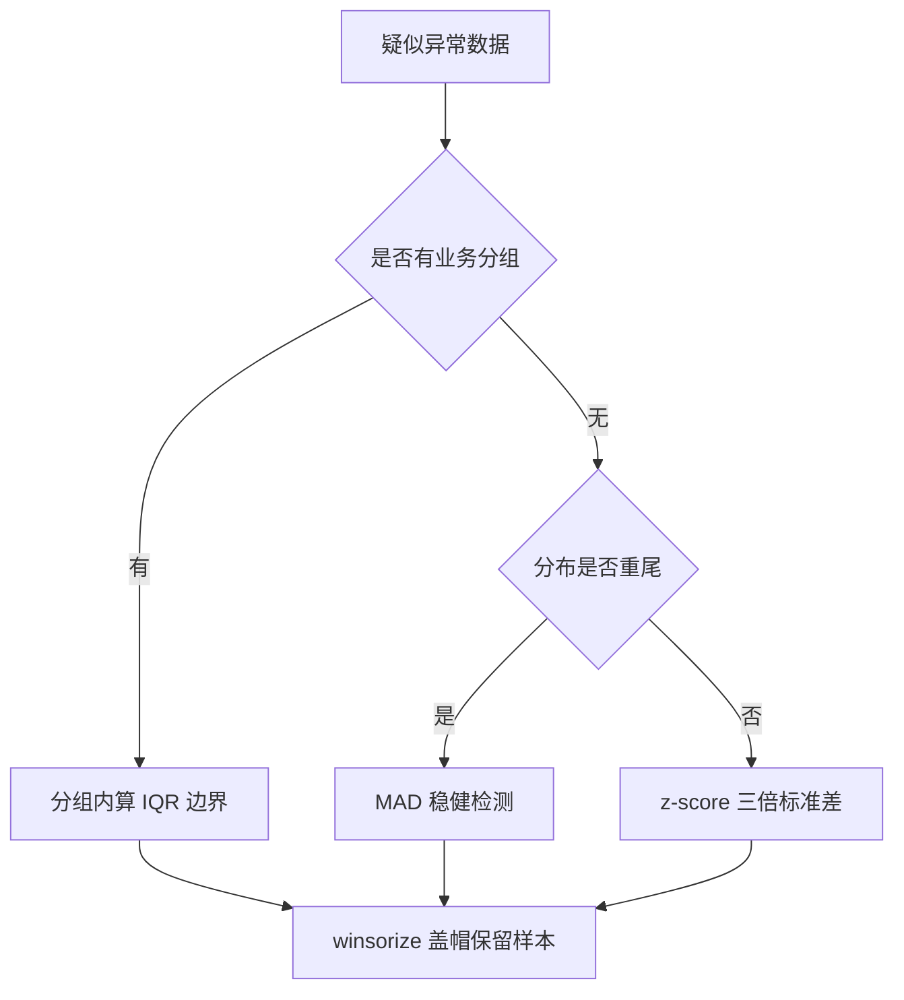

### Q1054 · MAD 稳健异常检测

> 难度:★★★☆ | 标签:统计, 异常检测

**问**:IQR 和 z-score 之外,为什么很多风控团队用 MAD?它怎么和标准差对齐?

**答**:MAD(中位绝对偏差)= median(|x - median(x)|),中位数有 50% 崩溃点,少量极端值几乎不影响它,天然抗污染。乘系数 1.4826(正态下 MAD 的期望换算)后可与 σ 直接比较,得到"稳健 z 分数":`0.6745 * |x - median| / MAD`,常用阈值 3.5(即 Iglewicz-Hoaglin 规则)。工程建议:监控类指标默认 MAD,报表盖帽用分组 IQR,两者都比 z-score 稳;MAD 也可能为 0(过半数据相同,如转化率列),此时退化为固定分位数规则。

```python
# file: code/05_数据分析与工程化/q1054_mad_outliers.py
import statistics

def mad_flags(xs, k=3.5):
    med = statistics.median(xs)
    mad = statistics.median([abs(x - med) for x in xs])
    if mad == 0:
        return med, mad, [i for i, x in enumerate(xs) if x != med]
    scores = [0.6745 * abs(x - med) / mad for x in xs]
    return med, mad, [i for i, sc in enumerate(scores) if sc > k]

data = [10, 11, 12, 12, 13, 12, 11, 500]
med, mad, flags = mad_flags(data)
print("中位数:", med, "MAD:", mad)
print("异常下标:", flags, "对应值:", [data[i] for i in flags])
print("z-score 对照:均值", round(statistics.mean(data), 1), "被 500 严重拉高")
```

**追问**:
- 追问 1:0.6745 是怎么来的?—— 正态分布下 MAD 约等于 0.6745σ,除以它让稳健分数与经典 z 同量纲。
- 追问 2:MAD 为 0 怎么办?—— 换 meanAD 或直接用四分位规则,本质都是换更不敏感的尺度估计。


