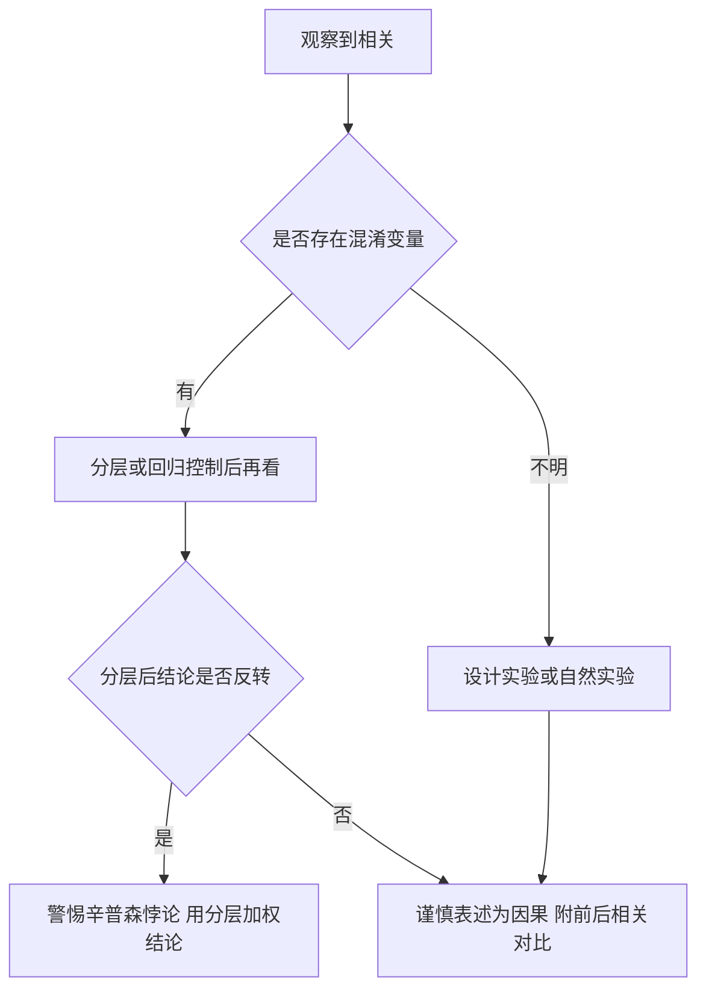

### Q1060 · bootstrap 置信区间

> 难度:★★★★ | 标签:统计, 实验

**问**:中位数、P99 这种没有解析公式的统计量,怎么给置信区间?

**答**:bootstrap:对原始样本有放回重采样 B 次(工程上 1000 到 10000),每次计算目标统计量,取经验分布的 2.5%/97.5% 分位作为 95% 置信区间(百分位法)。它对任意统计量都适用、不依赖分布假设,特别适合分位数和自定义业务指标;代价是计算量随 B 线性增长,大样本时可以先抽样或用并行。注意:bootstrap 反映的是采样不确定性,不修正测量偏差;A/B 对比常用"两组差值的 bootstrap",重采样要在组内独立进行。

```python
# file: code/05_数据分析与工程化/q1060_bootstrap_ci.py
import random
import statistics

random.seed(7)
data = [random.expovariate(0.2) for _ in range(300)]
means = []
for _ in range(4000):
    sample = [random.choice(data) for _ in range(len(data))]
    means.append(statistics.mean(sample))
means.sort()
lo, hi = means[int(0.025 * len(means))], means[int(0.975 * len(means))]
print(f"样本均值 {statistics.mean(data):.3f}")
print(f"bootstrap 95% CI [{lo:.3f}, {hi:.3f}]")
assert lo < statistics.mean(data) < hi
print("区间覆盖点估计,方法对均值、中位数、P99 通用")
```

**追问**:
- 追问 1:百分位法和 BCa 法的差别?—— BCa 对偏态与偏差做了校正更准,百分位法在偏态统计量(如方差)上会略偏。
- 追问 2:B 取多少够?—— 95% 区间 1000 起步,发表级或尾部指标(P99)建议 10000 并固定种子。


