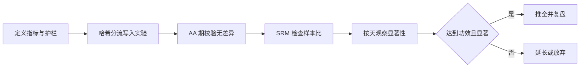

### Q1066 · 留存矩阵 cohort 透视

> 难度:★★★★ | 标签:分析, 留存

**问**:次月留存、7 日留存说法很多,经典的留存矩阵怎么用 pandas 一次算出来?

**答**:三步:给每个用户定 cohort(通常是首次行为月,如首单月);把用户每月活跃事件按用户-月展开;用"活跃月 - cohort 月"得到偏移月数,再对 cohort x 偏移做计数透视,除以 cohort 人数即得留存矩阵。实现上 `merge(用户首月表, 活跃月表)` 后算偏移,再 pivot;报表上矩阵对角线就是同一个月的不同生命周期,第 N 列均值即 N 月留存率。口径要点:活跃定义(登录/下单)必须和 cohort 定义一起冻结,否则矩阵前后不可比。

```python
# file: code/05_数据分析与工程化/q1066_retention_matrix.py
from collections import defaultdict

first_purchase = {"u1": "2026-01", "u2": "2026-01", "u3": "2026-02"}
active_months = defaultdict(set)
active_months["u1"] = {"2026-01", "2026-02", "2026-03"}
active_months["u2"] = {"2026-01", "2026-03"}
active_months["u3"] = {"2026-02", "2026-03"}

def offset(a, b):
    ya, ma = int(a[:4]), int(a[5:])
    yb, mb = int(b[:4]), int(b[5:])
    return (yb - ya) * 12 + (mb - ma)

cohort_size = defaultdict(int)
matrix = defaultdict(lambda: defaultdict(int))
for user, c in first_purchase.items():
    cohort_size[c] += 1
    for m in active_months[user]:
        matrix[c][offset(c, m)] += 1

months = sorted(cohort_size)
print("cohort  人数  M0    M1    M2")
for c in months:
    row = [f"{matrix[c][k] / cohort_size[c]:.0%}" if matrix[c][k] else "-" for k in range(3)]
    print(f"{c}  {cohort_size[c]:>4}  " + "  ".join(f"{x:>4}" for x in row))
```

**追问**:
- 追问 1:cohort 用首单还是首访?—— 看业务目标,交易业务常用首单避免"只逛不买"稀释矩阵,口径须固定。
- 追问 2:滚动留存和当期留存差别?—— 当期按自然月对齐,滚动按"自首次起 N 天内",后者对低频业务更公平。


